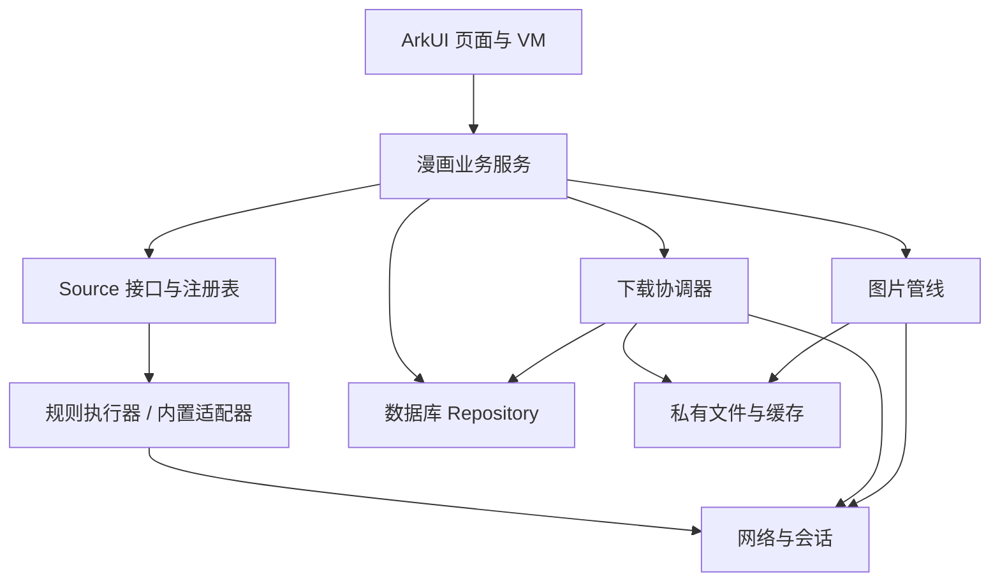
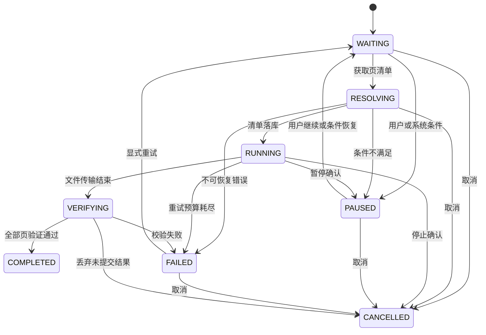

# 原生鸿蒙漫画阅读应用：详细实施方案

版本：方案 1.0；核查日期：2026-10-17（北京时间）。目标读者：有基础编程知识、缺少鸿蒙项目经验的开发者。

本文是一份实施设计，不是已完成的应用。全部鸿蒙编译、模拟器和真机验证均为**待执行**；文中接口、JSON 与配置都是**未编译验证的设计示例**，不能直接视作可运行项目。没有真实目标网站，不能宣称已完成真实源适配。

## 0. 整体结论、假设和先后顺序

**结论：对有稳定 JSON 接口或可由静态 HTML 提取内容、允许相应访问的目标网站，本地独立运行的原生鸿蒙漫画应用具备可行的工程路线。对任意网站、现有 Android APK 扩展兼容、复杂反自动化挑战、永不停止的后台任务，不作承诺。**

选定主路线：ArkTS（鸿蒙应用编程语言）＋ArkUI（鸿蒙原生界面框架）＋Stage 模型（组织应用页面和生命周期的应用模型）；一个 entry 应用模块；统一 Source 接口；有限声明式 JSON 规则；少量随应用编译发布的专用适配器；RCP 原生网络封装；ArkData 关系型数据库；应用私有文件；系统下载代理配合持久化队列。运行时不需要自建服务器，不下载执行脚本。

“声明式”是告诉引擎请求哪个地址、从哪个字段取值，而不是让规则任意执行程序。“适配器”是把某个网站的特殊数据格式转换为共同接口的代码。“API”是程序之间约定的调用入口；系统 API 等级决定某项系统能力是否能调用。

默认首版目标为 **HarmonyOS 6.0.0 / API 20 及以上的手机**；开发基线为 DevEco Studio 6.0.0 Release 系列与其配套 HarmonyOS 6.0.0 Release SDK。该基线不是“当前最新版本”。最低兼容、目标、编译 API 暂统一为 20，减少初学者兼容分支。官方样例明确列出 API 20、上述 IDE 和 SDK 的组合 [H01]；**准确补丁构建号、可下载性、目标手机支持情况仍须在 T01 记录，不声称本次已核实补丁级匹配**。若现有设备低于 API 20，先调整基线并重跑全部风险原型，不在开发后期才补兼容。

默认首版支持：UTF-8、HTTPS、无需登录的 JSON／静态 HTML 源；JPEG、PNG、静态 WebP；单源搜索；页式及条漫；用户主动下载；源文件手动导入和手动更新；单设备数据。JSON 是结构化文本数据，HTML 是网页内容标记，CSS 选择器是定位网页元素的表达式。后三者均不等于完整浏览器运行环境。

### 0.1 五个会影响决策的问题（不等待回答即可做通用原型）

1. 首批目标源的主页、搜索示例、漫画详情、章节和图片各是什么 URL？至少给两个源，并说明访问及下载许可、地区限制、是否登录。
2. 最低目标手机型号、实际系统版本和 API 等级是什么？有无至少一台可调试真机？默认 API 20。
3. 首版仅自用安装，还是计划应用市场发布？默认先完成可安装的开发交付；上架是单独关卡。
4. 关闭应用／锁屏之后，你是否要求整批章节无需重新打开应用也能下载完？默认只保证系统允许范围内继续已提交任务，并保证重新打开后的恢复。
5. 首批目标源是否必须支持登录、付费账号、动态脚本或特殊图片解码？默认首版不需要；若答案是必须，则登录／解码原型提升为首版阻塞项。

必须补充的目标源资料：上述地址、1 部可公开验证的漫画及至少 3 章、预期页数与顺序、图片格式和最大尺寸、请求头、登录流程、脱敏响应样本、内容使用边界。账号密码不写入规则、日志或仓库。

### 0.2 最危险的假设与验证顺序

顺序为 G0 环境与设备 → G1 双解析器和规则变化 → G2 真实源全链路 → G3 长图与内存 → G4 下载、进程退出和离线恢复。登录 G5 在增强阶段前通过；若首批网站要登录，与 G2 同时通过。不能先做大量页面再发现读不到图片。

| 关卡 | 通过证据 | 不通过时的动作 |
|---|---|---|
| G0 | API20 模板在模拟器与真机安装，RCP／数据库／文件最小调用成功 | 固定能实际使用的工具链；不开始批量业务编码 |
| G1 | JSON 与 HTML 两个规则通过同一 Source 接口完成四类操作；只改规则修复样本改版；Release 也能解析 | 修复／固定 HTML 依赖；不能把删除 HTML 支持算通过 |
| G2 | 每个约定真实源搜索→目录→全部图片成功，重复两次且跨应用重启 | 调查请求、编码、会话；必要时内置适配器；目标源未提供则保持阻塞 |
| G3 | 约定长图测试集可阅读、缩放；峰值内存及退出回收达标 | 调整分块解码；必要时增加原生解码桥接；不可仅缩小到字不可读 |
| G4 | 下载异常可恢复，飞行模式重启后续读；真机后台行为有记录 | 前台可靠下载必须通过；后台降低承诺必须显式变更范围 |
| G5 | 真实登录源登录→原生图片请求→过期重登成功；无串源 Cookie | 不发布该登录源；不能用 Web 能打开替代原生请求成功 |

## 1. 证据核查与技术决策

结论标签：**[确认] 官方文档或源码已确认**；**[推断] 基于现有信息的工程推断／本文设计决策**；**[待验] 需要原型或实机验证**。未另标的具体数值、数据结构、模块划分和任务安排均为本文设计，不是平台保证。

### 1.1 本次实际查到了什么

已下载并阅读 Mihon 源码，固定提交为 `446f6df82c390ab760802c2fce3b677bce3f31c1`，提交时间 2026-10-13。下列 M 系列链接均固定该提交，不能拿其他版本的方法名替代。访问了华为官方文档和检索结果，但若干参考页面只返回空壳或超时；相关条目在 H 系列表明访问范围。另读取了 OpenHarmony 官方 docs 源文档作补充，仓库 master 查询到 `f41b9345badd47c7ab0c263344cd7f4b5a549afb`；它是 OpenHarmony 的证据，不等价于已验证华为商业 SDK。当前环境未发现 `hvigor`、`hdc` 可执行命令，也没有可用鸿蒙真机，因此没有执行鸿蒙构建。

| 核查项 | 所见机制和证据 | 可以借鉴／不能直接搬用 |
|---|---|---|
| 源接口 [确认] | Source 有稳定标识、搜索、漫画更新和页列表；HttpSource 把请求与解析分开，并允许先取页面再解析图片地址 [M01,M02] | 借鉴统一契约及延迟图片解析；不照抄 Kotlin 协程、RxJava 类型。当前 Source 含 getMangaUpdate，不应只按旧版 fetch 系列描述 |
| 扩展加载 [确认] | ExtensionLoader 读取 Android 包信息、扩展元数据和签名，经类加载器实例化扩展；区分共享／私有扩展 [M03] | 鸿蒙重新定义源配置协议；不运行 APK、DEX 或 Android 类加载器 |
| 网络 [确认] | NetworkHelper 使用 OkHttp、AndroidCookieJar、缓存和拦截器 [M04] | 借鉴集中网络策略；Java／Android 库不能当作 ArkTS 包安装 |
| HTML [确认] | ParsedHttpSource 使用 Jsoup；该辅助类在所查版本已标记弃用，提示其抽象有局限 [M05] | 借鉴请求／解析分离；不能把 Jsoup 或通用 CSS 能力视作鸿蒙内置功能 |
| 阅读 [确认] | ReaderPageImageView 按图像类型选择视图，普通静态图有 SubsamplingScaleImageView，条漫有分条视图，存在取消与回收路径 [M06] | 借鉴按可见区域加载、回收；Android View、Coil 及对应解码器需要替换 |
| 下载 [确认] | Downloader 组织并发、临时文件、重试及完整性检查，再更新下载索引 [M07] | 借鉴状态与文件提交顺序；Android 生命周期、文件封装不能照搬 |
| 存储 [确认] | SQLDelight 表定义与 AndroidX SQLite 驱动，漫画、章节、分类、历史分表 [M08,M09] | 借鉴实体关系；首版重写 ArkData 数据访问，不引入 Android 数据库驱动 |
| 许可证 [确认] | Mihon 仓库根 LICENSE 为 Apache-2.0 [M10] | 本项目优先独立实现；若复制代码须保留适用声明并核查具体文件与依赖。仓库许可证不授予第三方漫画内容使用权 |

### 1.2 系统能力与证据强弱

| 能力 | 主选型 | 已确认范围 | 尚需验证 |
|---|---|---|---|
| 网络请求 | `@kit.RemoteCommunicationKit` 的 rcp；封装于 RcpTransport | 华为官方示例确认 createSession、Request 及请求／流式能力 [H02,H03,H04] | API20 上单请求取消、关闭自动重定向、Cookie 属性保持、流写入的精确签名与行为 |
| 数据库／设置 | `@kit.ArkData` 的 relationalStore／preferences | 官方数据库文档确认关系库和持久文件；版本变更表含 getRdbStore [H05] | API20 的具体事务重载、备份方式；不使用新文档才新增的 API |
| 文件 | `@kit.CoreFileKit` 的文件访问，context.filesDir／cacheDir | 华为文件上传下载指南与缓存样例；OpenHarmony fs 参考 [H01,H06,O04] | 下载代理可写路径、URI 与普通路径转换、rename 行为 |
| 图片 | `@kit.ImageKit` 的 ImageSource／PixelMap | 华为示例确认读图片信息和按尺寸解码；OpenHarmony 定义区域解码参数 [H07,O03] | 特定格式是否真正避免全图解码、峰值内存与分块拼接 |
| Web 登录 | ArkWeb 的 Web 组件、WebCookieManager | OpenHarmony 官方文档含 fetchCookie／configCookie，标有最低 API [O02] | 华为对应 API20 行为、HttpOnly、同域隔离、认证网站能否使用 |
| 后台传输 | Basic Services Kit 的 request.agent | 华为官方示例使用代理下载；OpenHarmony 定义 BACKGROUND、任务查询及暂停恢复 [H06,H08,O01] | 进程退出、重启、任务留存、凭据过期、厂商电源管理 |
| 后台调度 | Background Tasks Kit 的 workScheduler，增强阶段 | 官方说明后台任务受约束，OpenHarmony 有条件式工作调度 [H09,O05] | 调度频率和触发时机；不能承诺定点更新 |

特别注意：OpenHarmony 当前 HTTP 文档把 `http.HttpRequestOptions.maxRedirects` 标记为 API23+ [O06]。因此不能在 API20 的方案里直接写 `maxRedirects: 0` 并宣称可用。首选 RCP 是为集中会话与受控请求留出能力，关闭自动重定向的具体 API20 配置必须在 T03 查 SDK 声明并验证；若不能实现，按 6.2 的替代路径处理。

### 1.3 选型和切换条件

| 决策 [推断] | 为什么采用 | 不选的主要方案 | 何时切换及受影响模块 |
|---|---|---|---|
| 原生 ArkTS／ArkUI | 直接接系统文件、图像、数据库与生命周期；不需跨平台桥接层 | 不用 Web 套壳；不尝试直接重编 Kotlin Android 应用 | 明确新增其他平台目标后才评估共享核心；UI、平台封装变化，Source 数据契约保留 |
| 单 entry、按目录分模块 | 初学者能跟踪调用，不需多 HAR／依赖注入框架 | 不先做复杂多模块、插件市场和全局事件总线 | 团队扩大或编译边界有实际收益时拆模块；先保持目录层级 |
| 有限规则＋内置适配器 | 规则更新能修常见字段和布局变化；特殊流程有明确出口 | 首版不装脚本引擎、不下载执行 ArkTS／JS | 多个合法目标源反复需要同类转换，才扩 DSL；网站独特算法写适配器，影响源层与发布节奏 |
| RCP＋系统代理 | 数据请求与系统托管传输职责清楚 | 不同时在 UI 混用 HTTP、Axios、Web fetch | RCP 关键控制不满足时替换 Transport；协议、业务、页面不改 |
| relationalStore＋私有文件 | 关系查询、事务适合书架和队列；图片放文件节省数据库开销 | 不将所有内容塞 preferences，不建默认云后端 | 云同步是独立增强；增加同步日志，不更改本地读取优先原则 |
| HTML 优先验证 @ohos/htmlparser2 | 有鸿蒙适配线索，上游是独立解析器 | 不默认 npm 的 Cheerio／Jsoup 可运行；不自写完整 HTML 解析器 | 包不可编译时审计并随工程固定兼容源码；仍不可行则经技术负责人评估 native 解析库。改变源执行模块，延期而非悄悄删 HTML |

## 2. 需求边界与成功定义

| 编号 | 阶段 | 要求及边界 |
|---|---|---|
| R01 | 首版 | 导入本地源 JSON；列出、启停、手动更新、回滚、移除；格式不兼容须明确报错 |
| R02 | 首版 | 单源关键词搜索，分页；不要求热门／推荐／复杂筛选 |
| R03 | 首版 | 详情与完整章节目录；排序、去重；分页抓取中断不得覆盖完整旧目录 |
| R04 | 首版 | 获取有序图片清单；支持必要时二次解析、地址过期刷新 |
| R05 | 首版 | 页式左右阅读、条漫滚动、缩放、预加载、图片失败重试 |
| R06 | 首版 | 收藏、分类、分类筛选、取消收藏；分类是多对多 |
| R07 | 首版 | 阅读历史和页内位置保存；退出、重启、章节更新后恢复 |
| R08 | 首版 | 章节下载、队列、暂停、取消、重试、启动恢复、离线读取 |
| R09 | 首版 | 两种演示源跑同一引擎，并完成最终约定的真实目标源适配；模拟成功不能替代后半项 |
| R10 | 首版 | 可安装构建、权限正确、错误可定位、数据库升级和基本性能达标 |
| R11 | 首版 | 受控规则；不串源凭据；不访问任意本地路径；不执行外部代码 |
| R12 | 后续 | 多源并发搜索，分源展示、部分失败、取消；不默认同名合并 |
| R13 | 后续 | HTTPS 订阅清单、更新预览、版本和来源信任、失败回滚 |
| R14 | 后续 | 书架章节更新检查：手动及回到前台触发；系统调度作为尽力执行 |
| R15 | 后续 | 备份与恢复：书架、分类、进度、源配置；图片单独可选；不导出登录秘密 |
| R16 | 后续 | 经逐源验证的 Web 登录／会话衔接；不承诺所有认证机制 |
| X01 | 当前不做 | Android APK 扩展兼容、DEX/JVM 模拟、Mihon 全功能复刻 |
| X02 | 当前不做 | 任意脚本、验证码自动破解、绕过付费／DRM、设备指纹挑战通用解决 |
| X03 | 当前不做 | 默认服务器、中转抓取、跨设备云同步、评论推荐系统 |
| X04 | 当前不做 | 永久后台、精确定时更新、安装即保证应用市场审核通过 |

**支持的网站类别**：优先公开 JSON 或静态 HTML，图片是独立 HTTPS 资源，合理请求头即可访问；可有分页、懒加载属性和短期签名地址。JavaScript 执行后才生成全部数据的网页，必须先确认存在合法可调用的数据接口；否则需专用适配器或不列入支持清单。首版图片上限由 G3 锁定；动画、HEIF/AVIF、加密拼图不默认支持。

完成定义分两层：A“应用核心完成”是演示源及本地机制通过；B“项目首版交付完成”还必须包括指定真实源、真机安装和功能验收。缺 B 不能对外声称项目目标全部实现。

## 3. 用户流程与页面

主入口是书架／浏览／下载／历史四个页签。浏览进入源管理与单源搜索。搜索结果进入详情，详情含章节目录，章节进入阅读。阅读可收藏和下载；下载列表进入同一阅读器的离线模式。页面导航只传本地主键或 SourceRef，不传带 Cookie 的整块对象。

| 页面／文件（pages/） | 主要操作和展示 | 数据来源 | 加载、空、失败、离线与恢复 |
|---|---|---|---|
| HomePage、LibraryPage | 分类、封面、未读数、继续阅读 | LibraryRepository＋ProgressRepository | 首次读取短加载；空书架引导添加源；查询失败重试；离线照常显示，本地封面优先 |
| SourcesPage | 名称、版本、状态、能力、启停、删除 | SourceRegistry＋SourceRepository | 空列表导入；失效源显示原因；禁用不删数据；导入失败保留原源 |
| SourceImportPage | 文件选择或后续订阅 URL，权限／域名／版本差异预览 | RuleValidator 解析暂存件 | 校验中禁止重复提交；不兼容标字段；取消不修改现有；离线允许本地导入 |
| SearchPage | 关键词、源名称、结果、加载更多 | CatalogService.search，经 Source 调用 | 防抖300ms；新搜索取消旧请求；无结果与解析失败不同；失败保留已有页并重试；离线仅可查看已有结果并标过期 |
| DetailPage | 封面、作者、简介、来源、收藏／分类、目录、下载选择 | 先 MangaRepository 缓存，再刷新 | 有缓存就先显示；无章节注明是否源确认为空；刷新失败不清旧目录；离线只能进入已下载章节 |
| ReaderPage | 页码、缩放、方向、条漫、前后章、收藏、下载 | ReaderSession＋PageAssetRepository | 当前页占位，单图错误卡片；重试当前页／刷新地址；离线缺页明确列出；退出写进度 |
| DownloadsPage | 状态、已完成页数／总数、空间、暂停／继续／取消 | DownloadRepository＋DownloadCoordinator | 恢复中显示扫描状态；空队列给入口；失败显示可执行动作；离线暂停网络但可读已完成页 |
| HistoryPage | 最近阅读漫画、章节、位置、时间 | HistoryRepository | 空历史说明；离线正常；失效章节允许打开本地内容或重新选章 |
| SettingsPage | 阅读默认项、缓存上限、Wi-Fi策略、清理缓存、版本、诊断导出 | preferences＋缓存索引 | 清理前报可回收大小；不把离线下载算缓存；失败给文件/空间错误码 |
| LoginPage（后续） | 官方登录域名、网页、完成登录、退出账号 | LoginCoordinator＋ArkWeb | 取消不当作成功；验证接口成功才更新已登录；离线禁止登录；失败返回源详情 |
| BackupPage（后续） | 导出、导入、内容预览、冲突处理 | BackupService | 写入进度、空间不足、无效版本；恢复失败回滚，原数据保留 |

统一 UI 状态用 `idle/loading/ready/empty/error/offline` 加 `stale`、`errorMessage`、`retryAction`。部分图片或单个源失败不把整个页面清空。VM 是页面状态类，只做输入收集和状态更新；网站字段解析放源层。

## 4. 架构与目录

### 4.1 调用边界

UI → 页面 VM → 业务服务 → 源接口／Repository。Repository 是只负责读写某类数据的访问类。业务服务组织“刷新目录、收藏、开始阅读”等用例；源层只理解网站；网络层只负责受控传输；文件层只理解本地路径。所有实例在 AppContainer 手动组装传入，不引入依赖注入框架。



| 模块 | 解决问题；输入→处理→输出 | 由谁调用 |
|---|---|---|
| UI／VM | 用户操作→校验、调用用例、状态映射→可显示状态 | ArkUI 生命周期及事件 |
| 漫画业务 | SourceRef／本地主键→缓存读取、源刷新、合并→详情、目录、阅读会话 | VM、更新检查 |
| 源管理 | 规则文件与开关→校验、版本激活、实例创建→可用 Source | 浏览页、业务服务 |
| 源执行 | 操作名及参数→模板、网络、提取、转换→标准实体 | 业务、图片地址解析 |
| 网络／会话 | 受控 RequestPlan＋sourceId→域名策略、限流、凭据、传输→ResponseData | 源、图片管线、下载 |
| 数据存储 | 标准实体→事务、查询、迁移→本地记录 | 业务、下载、源管理 |
| 图片管线 | PageRef＋显示尺寸→本地优先、解析／下载、解码、回收→图像资源句柄 | 阅读器与封面组件 |
| 下载管理 | chapterId→持久队列、页清单、传输、校验→离线清单及状态 | UI、应用启动恢复 |

### 4.2 建议目录（路径清单，不代表已有代码）

```text
AppScope/app.json5
build-profile.json5
oh-package.json5 / oh-package-lock.json5
hvigor/hvigor-config.json5
entry/oh-package.json5
entry/src/main/module.json5
entry/src/main/ets/
  entryability/EntryAbility.ets
  app/AppContainer.ets
  model/SourceTypes.ets, ComicTypes.ets, ErrorTypes.ets
  pages/（第3章页面）
  vm/SearchVM.ets, DetailVM.ets, ReaderVM.ets, LibraryVM.ets, DownloadsVM.ets
  business/CatalogService.ets, LibraryService.ets, ReaderSession.ets
  business/ChapterSyncService.ets, UpdateCheckService.ets, BackupService.ets
  source/Source.ets, SourceRegistry.ets, SourceImportService.ets
  source/rules/RuleTypes.ets, RuleValidator.ets, RuleSource.ets
  source/rules/TemplateRenderer.ets, JsonExtractor.ets, HtmlExtractor.ets
  source/rules/SelectorSubset.ets, Transforms.ets
  source/adapters/（逐网站命名的内置适配器）
  network/Transport.ets, RcpTransport.ets, RequestPolicy.ets
  network/SessionStore.ets, CookieJar.ets, RequestScheduler.ets, UrlPolicy.ets
  storage/Database.ets, Migrations.ets, FileStore.ets
  storage/SourceRepository.ets, MangaRepository.ets, ChapterRepository.ets
  storage/LibraryRepository.ets, ProgressRepository.ets, HistoryRepository.ets
  storage/DownloadRepository.ets, CacheRepository.ets
  reader/PagedViewer.ets, WebtoonViewer.ets
  image/PageAssetRepository.ets, MemoryImageCache.ets, DiskImageCache.ets
  image/ImageDecoder.ets, TileProvider.ets, Prefetcher.ets
  download/DownloadCoordinator.ets, AgentTransfer.ets, DownloadRecovery.ets
  download/ManifestStore.ets, FileVerifier.ets
  login/LoginCoordinator.ets（后续）
  diagnostic/DiagnosticLog.ets
entry/src/main/resources/rawfile/demo-rules/
entry/src/ohosTest/ets/（设备自动化与最小验证）
entry/src/test/（工具链支持的本地逻辑测试）
tools/fixtures/（自有 JSON、HTML、图片、故障模拟）
docs/environment.md, source-contract.md, sources/<sourceId>.md
docs/verification.md, release.md, THIRD_PARTY_NOTICES.md
```

model 不导入 UI、数据库或网站；network 不导入 source；source 不能直接拿数据库连接或文件根目录；download 通过 SourceRegistry 取得源，但源不反向调用 download。阅读器与下载通过 PageAssetRepository 共享已完成文件，避免互相等待。跨模块沟通用方法返回值和少量具名状态订阅，订阅在离开页面时释放。

## 5. 源协议与执行引擎

### 5.1 标识、契约与错误

SourceId 是人为分配、不可因名称或域名变化而改变的字符串，如 `org.example.demo.json`。sourceVersion 是递增整数；ruleFormatVersion 固定为1；engineVersion 使用整数1；engineMin／engineMax 是允许的引擎闭区间。三种版本不能混用。能力标记 `search/details/chapters/pages/resolveImage/login` 用于判断是否支持操作；首版前四项必须有。

以下为**未编译的接口设计伪代码（接近 ArkTS，最终以 SDK 语法约束调整）**。Promise 表示结果稍后返回。CancelScope 是本项目实现的取消对象，不是假定鸿蒙内置 AbortSignal。

```ts
interface SourceRef { sourceId: string; remoteId: string; locator: string; }
interface PageToken { kind: string; value: string; } // page/cursor/url
interface CallContext {
  callId: string; deadlineMs: number; cancel: CancelScope;
  ruleRevision: number; // 一个调用固定使用同一版本规则
}
interface Batch<T> { items: T[]; next?: PageToken; }
interface MangaSummary { ref: SourceRef; title: string; cover?: string; }
interface MangaDetail {
  ref: SourceRef; title: string; authors: string[];
  description: string; tags: string[]; cover?: string; status: string;
}
interface ChapterRef {
  ref: SourceRef; mangaRemoteId: string; title: string;
  ordinal: number; volume?: string; numberText?: string; uploadedAt?: number;
}
interface PageRef {
  pageKey: string; ordinal: number; locator: string;
  imageUrl?: string; expiresAt?: number; width?: number; height?: number;
}
interface HeaderPair { name: string; value: string; }
interface ImageRequest {
  url: string; headers: HeaderPair[]; expiresAt?: number;
  contentRevision: string; // 版本标识，与临时签名 URL 分开
}
interface Source {
  id: string; version: number;
  search(query: string, token: PageToken | undefined, ctx: CallContext): Promise<Batch<MangaSummary>>;
  details(manga: SourceRef, ctx: CallContext): Promise<MangaDetail>;
  chapters(manga: SourceRef, token: PageToken | undefined, ctx: CallContext): Promise<Batch<ChapterRef>>;
  pages(chapter: SourceRef, token: PageToken | undefined, ctx: CallContext): Promise<Batch<PageRef>>;
  resolveImage(chapter: SourceRef, page: PageRef, forceRefresh: boolean, ctx: CallContext): Promise<ImageRequest>;
}
```

details 返回标准详情；chapters／pages 同样可分页，业务层完整收集后再形成目录／章节清单。UI 不自己拼下一页 URL。resolveImage 默认用已知 imageUrl；有延迟解析时请求 page.locator；强制刷新需重新获取页列表或单页资源，按 pageKey 对齐。内置适配器实现同一接口，也必须使用受控 Transport，不能绕过限流与会话。

统一错误 `SourceError` 包含 `code/sourceId/operation/callId/retryable/retryAfterMs/httpStatus/fieldPath/safeMessage`。错误对象不含 Cookie、密码、完整签名查询参数和完整响应正文。代码集：DISABLED、RULE_INVALID、ENGINE_INCOMPATIBLE、UNSUPPORTED、OFFLINE、TIMEOUT、CANCELLED、RATE_LIMITED、AUTH_REQUIRED、ACCESS_DENIED、NOT_FOUND、HTTP_SERVER、PARSE_ERROR、EMPTY_UNEXPECTED、IMAGE_EXPIRED、CONTENT_CHANGED、POLICY_DENIED。文件层另有 STORAGE_FULL、IO_ERROR、CORRUPT_FILE；UI 显示中文操作建议，日志留错误码。

一个错误不能简单按 HTTP 状态猜测：401 通常转登录；403 可能是禁止、挑战或签名过期，只有规则／适配器明确识别签名失效才 IMAGE_EXPIRED；HTML 中出现登录页面不得当成“零章”；字段缺失是 PARSE_ERROR；源明确返回空数组才是正常空结果。

### 5.2 请求、分页和资源限额

元数据默认连接10秒、总时限30秒；图片连接10秒、单次传输总时限60秒，超大图专项调整上限。使用应用绝对 deadline 限制跨重试累计耗时；不是每次重试重新获得无限30秒。取消触发后中止底层请求、撤销队列、禁止旧结果写入页面；仍到达的回调凭 callId／generation 丢弃。

全局前台网络并发4、每源2；下载图片每源2、全局2，交互请求优先；最低同源请求间隔500ms。源只能要求更低并发／更慢，不可放宽应用上限。同站点不同源还要按目标 host 共享上限。重试仅幂等 GET／HEAD 的连接错误、超时、部分5xx；最多额外2次，等待1秒、2秒再加小随机抖动。429 尊重 Retry-After，上限等待120秒后标暂停，不能持续轰击。解析失败不盲重试。

分页 token 由引擎生成并绑定 sourceId、操作、query、ruleVersion；界面只能原样回传。page 为正整数；cursor 为不透明字符串；url 必须再次通过域名校验。重复 token 或重复结果无进展即终止并报分页异常。目录最多100批／10000章，图片最多100批／2000页；达到上限明确报范围超限，不能当完整结果提交。元数据响应上限2MiB（解压后），深度64，HTML节点50000，每条规则不超过256KiB；解析工作可移到 worker，worker 是可单独终止的后台执行单元，不共享 UI 对象。

### 5.3 规则字段与解释器职责

| 字段 | 含义与校验 |
|---|---|
| id/name/sourceVersion | 身份、显示名、整数版本；不从名称自动推算身份 |
| ruleFormatVersion/engineMin/engineMax | 格式版本和兼容区间；不匹配则拒绝激活 |
| baseUrl/allowedHosts | HTTPS 基址、确切允许域名列表；加入 CDN 需用户确认 |
| capabilities | 支持的操作；声明与 operations 必须一致 |
| operations | search/details/chapters/pages 及可选 resolveImage，每项包含 request、extract、pagination |
| request | method、path 或受限 URL 变量、query、headers、可选 body；首版规则仅 GET，POST 留给后续或审核过的适配器 |
| extract | format=json/html，items 定位，fields 映射；details 为单对象，其余为集合；HTML可声明requiredMarker和emptyMarker |
| fields | from 或 selector/text/attr、required、default、transforms；值必须转换为指定标准类型 |
| pagination | mode=page/cursor/url/none；start、nextPath 或 nextSelector；空值终止 |
| imageHeaders | 图片专用非秘密头，如 Referer；实际 Cookie 由网络层注入 |
| policy | 只能收紧超时／并发；登录和秘密读取不是规则可扩展能力 |

模板变量限定 `query/page/cursor/mangaId/chapterId/pageLocator/mangaLocator/chapterLocator`。路径段逐段编码、query 独立编码；用户关键词不得替换 host。URL 变量必须来自已通过校验的 locator，不能用于文件路径。输出 URL 以**最终响应地址**为基准补全相对路径；HTML `<base>` 只有落在允许域名内才采用。URL 解析使用 SDK URL 工具并做兼容测试，不用字符串相加处理 `../`。

JSON 提取采用自定义“小路径”：`$.data.items`、`$.data.items[0].title`；字段映射内的 `id` 表示相对当前元素；不支持表达式、递归下降、过滤函数和任意脚本。不能拿动态对象随意索引就说 ArkTS 已支持 JSONPath：T08 必须封装已校验的 JSON 节点访问器，处理数组、数字、字符串、null 及类型错误。

HTML 支持子集：标签、`.class`、`#id`、`[attr]`、`[attr=value]`、后代空格、直接子代 `>`；`self` 表示当前元素。多个选择结果保持文档顺序。首版不支持伪类、XPath、`:has`、任意正则。SelectorSubset 是项目自行实现的受限匹配器；HTML 解析库只产生节点树，不会自动获得 CSS 查询能力。

转换白名单：trim、collapseWhitespace、string、integer、urlAbsolute、reverseList、唯一值去重、默认值；HTML 实体解码由解析器完成，不重复解码。禁止 eval、Function、动态模块、脚本变量取值、SQL、文件路径和任意正则替换。每个字段至多8步、每操作至多50个字段。新增能力先加版本和测试，再发布应用。

### 5.4 JSON 接口源：完整最小演示配置

**以下是设计用演示数据；example.invalid 不是真实源；未做鸿蒙运行验证。** FixtureServer 运行时以受控测试基址替换域名。JSON 源响应契约：搜索 `data.items=[{id,title,url,cover}], data.nextPage`；详情 `data={id,title,url,description}`；目录 `data.items=[{id,title,url,order}], data.nextPage`；页清单 `data.items=[{id,url}], data.nextPage`。nextPage 为 null 表示结束。

```json
{
  "id": "org.example.demo.json", "name": "JSON演示源", "sourceVersion": 1,
  "ruleFormatVersion": 1, "engineMin": 1, "engineMax": 1,
  "baseUrl": "https://example.invalid", "allowedHosts": ["example.invalid"],
  "capabilities": ["search", "details", "chapters", "pages"],
  "imageHeaders": {"Referer": "https://example.invalid/"},
  "operations": {
    "search": {
      "request": {"method": "GET", "path": "/api/search", "query": {"q": "{{query}}", "page": "{{page}}"}, "headers": {"Accept": "application/json"}},
      "extract": {"format": "json", "items": "$.data.items", "fields": {"remoteId": {"from": "id", "required": true, "transforms": ["string"]}, "title": {"from": "title", "required": true, "transforms": ["trim"]}, "locator": {"from": "url", "required": true, "transforms": ["urlAbsolute"]}, "cover": {"from": "cover", "transforms": ["urlAbsolute"]}}},
      "pagination": {"mode": "page", "start": 1, "nextPath": "$.data.nextPage"}
    },
    "details": {
      "request": {"method": "GET", "path": "/api/manga/{{mangaId}}"},
      "extract": {"format": "json", "object": "$.data", "fields": {"remoteId": {"from": "id", "required": true, "transforms": ["string"]}, "title": {"from": "title", "required": true}, "locator": {"from": "url", "required": true, "transforms": ["urlAbsolute"]}, "description": {"from": "description", "default": ""}}},
      "pagination": {"mode": "none"}
    },
    "chapters": {
      "request": {"method": "GET", "path": "/api/manga/{{mangaId}}/chapters", "query": {"page": "{{page}}"}},
      "extract": {"format": "json", "items": "$.data.items", "fields": {"remoteId": {"from": "id", "required": true, "transforms": ["string"]}, "title": {"from": "title", "required": true}, "locator": {"from": "url", "required": true, "transforms": ["urlAbsolute"]}, "ordinal": {"from": "order", "required": true, "transforms": ["integer"]}}},
      "pagination": {"mode": "page", "start": 1, "nextPath": "$.data.nextPage"}
    },
    "pages": {
      "request": {"method": "GET", "path": "/api/chapter/{{chapterId}}/pages", "query": {"page": "{{page}}"}},
      "extract": {"format": "json", "items": "$.data.items", "fields": {"pageKey": {"from": "id", "required": true, "transforms": ["string"]}, "imageUrl": {"from": "url", "required": true, "transforms": ["urlAbsolute"]}}},
      "pagination": {"mode": "page", "start": 1, "nextPath": "$.data.nextPage"}
    }
  }
}
```

未提取的 details.authors／tags 默认空数组，status 默认 unknown。SourceRef.sourceId 由引擎填充；ChapterRef.mangaRemoteId 来自调用参数；PageRef.ordinal 在完整合并后按顺序从0生成，locator 默认该 imageUrl，expiresAt 缺省表示未知。封面可缺，远程 ID／标题等必填不能默默补空。默认规则写入 source-contract.md，不能各解析器自己决定。

### 5.5 静态 HTML 源：完整最小演示配置

同样为**演示配置**。搜索页包含 `<a class="comic" data-id="m1" href="/manga/m1"><span class="title">示例</span></a>`；详情有 `h1.title`、`.summary`；目录有 `#chapters a.chapter[data-id][data-order]`；阅读页有 `#reader img[data-id][data-src]`；翻页链接 `a.next[href]`。这些元素需由测试服务返回，不能宣称来自真实漫画网站。

```json
{
  "id": "org.example.demo.html", "name": "HTML演示源", "sourceVersion": 1,
  "ruleFormatVersion": 1, "engineMin": 1, "engineMax": 1,
  "baseUrl": "https://example.invalid", "allowedHosts": ["example.invalid"],
  "capabilities": ["search", "details", "chapters", "pages"],
  "imageHeaders": {"Referer": "https://example.invalid/"},
  "operations": {
    "search": {
      "request": {"method": "GET", "path": "/search", "query": {"q": "{{query}}", "page": "{{page}}"}, "headers": {"Accept": "text/html"}},
      "extract": {"format": "html", "items": "a.comic", "fields": {"remoteId": {"selector": "self", "attr": "data-id", "required": true}, "title": {"selector": ".title", "text": true, "required": true, "transforms": ["trim"]}, "locator": {"selector": "self", "attr": "href", "required": true, "transforms": ["urlAbsolute"]}}},
      "pagination": {"mode": "url", "start": 1, "nextSelector": "a.next", "nextAttr": "href"}
    },
    "details": {
      "request": {"method": "GET", "url": "{{mangaLocator}}"},
      "extract": {"format": "html", "object": "body", "fields": {"title": {"selector": "h1.title", "text": true, "required": true, "transforms": ["trim"]}, "description": {"selector": ".summary", "text": true, "default": ""}}},
      "pagination": {"mode": "none"}
    },
    "chapters": {
      "request": {"method": "GET", "path": "/manga/{{mangaId}}/chapters", "query": {"page": "{{page}}"}},
      "extract": {"format": "html", "items": "#chapters a.chapter", "fields": {"remoteId": {"selector": "self", "attr": "data-id", "required": true}, "title": {"selector": "self", "text": true, "required": true, "transforms": ["trim"]}, "locator": {"selector": "self", "attr": "href", "required": true, "transforms": ["urlAbsolute"]}, "ordinal": {"selector": "self", "attr": "data-order", "required": true, "transforms": ["integer"]}}},
      "pagination": {"mode": "url", "start": 1, "nextSelector": "a.next", "nextAttr": "href"}
    },
    "pages": {
      "request": {"method": "GET", "url": "{{chapterLocator}}"},
      "extract": {"format": "html", "items": "#reader img", "fields": {"pageKey": {"selector": "self", "attr": "data-id", "required": true}, "imageUrl": {"selector": "self", "attr": "data-src", "required": true, "transforms": ["urlAbsolute"]}}},
      "pagination": {"mode": "url", "start": 1, "nextSelector": "a.next", "nextAttr": "href"}
    }
  }
}
```

HTML details 未返回 remoteId、locator 时继承入参，不重新生成身份。url 分页从初始 request 开始，后续完全使用已校验 next 链接。无下一页选择结果是正常终止；首屏结构标识不存在则解析失败。正式HTML规则必须为search/chapters/pages增加requiredMarker（表示已取得正确内容区域的选择器）和emptyMarker（网站明确空状态的选择器）；引擎先确认requiredMarker存在。items为0时，仅emptyMarker存在才返回正常空，否则EMPTY_UNEXPECTED。测试服务需提供这些标志，例如搜索外层#search-results和其内部.empty；上面的最小配置省略站点专属标志，作为教学配置仅在debug接受，正式导入校验不接受缺失标志。不能只用“选中0项”判断空。

延迟图片示例：pages 输出 pageKey 和 locator 而不输出 imageUrl；增加 resolveImage 操作 GET `{{pageLocator}}`，提取 `img.full` 的 src 或 JSON 的 `$.data.url`，可提取 `expiresAt`。到期前30秒刷新；401／403需按前述错误分类；一轮最多强刷一次。若 pageKey 不再存在，报 CONTENT_CHANGED，并要求重新载入章节，不能把新第5页当旧第5页。

### 5.6 HTML 库接入与新增源步骤

**已确认上游 htmlparser2 使用 MIT [L01]；未确认鸿蒙适配包当前稳定版本、完整依赖许可证及 API20 构建结果。** 官方 TPC 组织入口可检索到该适配项目，但本次未成功读取其当前主仓库关键文件 [L02]。搜索出现的历史样例／分叉和问题只能作为待核查线索，不能当主仓当前维护保证。因此不虚构精确包版本，也不写 `latest` 作为交付锁定值。

T05 的接入操作：从 OHPM 查询 `@ohos/htmlparser2` 发布信息与源码链接；下载对应发布包，记录确切版本、摘要、源码提交、更新时间、维护者和未关闭构建问题；读取 LICENSE、NOTICE、oh-package.json5，逐项核查 domhandler、domutils、entities、domelementtype、可能的 polyfill。先在隔离原型安装，调 parseDocument／事件解析获取树，包装为本项目 HtmlNode；不能把 ESObject 或动态属性传播到业务。Debug、Release、混淆构建各跑中文实体、错误闭合、懒加载、相对链接和2MiB上限样本。通过后固定精确版本与 lock 文件，归档许可证。若失败，先修导出路径／兼容依赖并使用本地固定 HAR 或源码，不关闭整个 ArkTS 检查掩盖问题。超过2天仍不通过，停止该任务，由技术负责人决定升级工具链或安排原生解析桥接；这是额外工作，不计为首版成功。

新增源：收集四类脱敏响应→确定稳定 ID 和允许域名→写规则→离线提取样本→设备真实请求→页序／过期／下载验证→发布适配说明。仅字段名、CSS 子集选择器、请求路径、既有分页／转换变化：配置更新即可。新的通用选择器、JSON 过滤、编码、转换：修改引擎、增加版本、重新发应用。专用签名、跨步骤业务、特殊解码：内置适配器并逐源验收。需要执行不受控站点脚本或依赖挑战浏览器指纹：首版不支持；若将来加入脚本引擎，必须重新评估资源隔离、超时、桥接白名单及上架政策。

## 6. 数据、网络与会话

### 6.1 数据模型

数据库使用关系型表，主键用于永久本地身份。时间统一 UTC 毫秒；UI 转本地时间。所有远程 ID 用字符串，避免长整型转换丢精度。下表 `PK` 是主键，`FK` 是指向另一表的引用，`UQ` 是唯一约束，索引用于加快查询。

| 表 | 主要字段 | 主键、关系、索引 |
|---|---|---|
| sources | id、name、kind、enabled、removed、active_version、last_good_version、updated_at | PK id；索引 enabled,removed |
| source_versions | source_id、version、rule_path、sha256、engine_min/max、state、created_at | PK(source_id,version)；FK sources；同版本不同摘要拒绝覆盖 |
| manga | id、source_id、remote_id、locator、title、authors_json、description、cover_url、status、content_revision、last_refresh | PK id；FK sources；UQ(source_id,remote_id)；索引 source_id,title |
| manga_aliases | source_id、old_remote_id、manga_id、reason | PK(source_id,old_remote_id)；FK manga；迁移审核后填 |
| chapters | id、manga_id、remote_id、locator、title、ordinal、volume、number_text、uploaded_at、missing、content_revision | PK id；FK manga；UQ(manga_id,remote_id)；索引(manga_id,ordinal,id) |
| favorites | manga_id、added_at | PK/FK manga_id；索引 added_at |
| categories | id、name、sort_order | PK id；UQ name |
| manga_categories | manga_id、category_id | PK(manga_id,category_id)；两个 FK；索引 category_id |
| reading_progress | chapter_id、page_key、page_index、in_page_ratio、reader_mode、read_complete、list_revision、updated_at、session_seq | PK/FK chapter_id；索引 updated_at |
| history | manga_id、chapter_id、last_read_at | PK/FK manga_id；FK chapter_id；索引 last_read_at；首版表示每部作品最近一次阅读 |
| download_tasks | id、chapter_id、revision、state、reason、total_pages、done_pages、retry_count、next_retry_at、created_at、updated_at、desired_action、generation | PK id；FK chapters；应用确保同章节同版本至多一个活动任务；索引(state,next_retry_at) |
| download_pages | task_id、page_key、ordinal、locator、ephemeral_url、expires_at、temp_path、final_path、bytes、etag、sha256、state、agent_tid、agent_token_ref、generation | PK(task_id,page_key)；FK task；UQ(task_id,ordinal)；索引 agent_tid |
| offline_manifests | chapter_id、revision、manifest_path、page_count、total_bytes、verified_at | PK(chapter_id,revision)；FK chapters；记录内容快照 |
| cache_entries | key、source_id、account_scope、content_revision、path、bytes、width、height、last_access、expires_at、pin_count | PK key；索引 last_access；索引 source_id；缓存可清除 |
| sessions（增强） | source_id、account_scope、secret_ref、session_epoch、updated_at | PK(source_id,account_scope)；数据库只放秘密引用，不明文存凭据 |
| schema_meta | version、last_migration_at | 单行；或用经过验证的 RdbStore.version，不维护两套版本真相 |

secret_ref 指向由系统密钥能力保护的私有秘密文件；HUKS 是鸿蒙密钥管理能力，实际接入放 T43，不凭名称假定自动加密。首版匿名 Cookie 可以只在内存中存，账号功能上线前完成持久保护。临时 URL 和 agent token 同样避免日志泄露、备份导出。

同名漫画由 `(source_id,remote_id)` 区分；不按标题自动合并。local id 一旦分配不随 URL 变化。优先取网站 ID；没有 ID 时使用**源规则定义的规范化路径**作为 remote_id，保留语义 query，不一概删除查询参数。域名迁移只改 locator/baseUrl。身份算法确需变化，写显式 alias 迁移，冲突保留两条并提示人工处理；不能删除旧收藏后重新导入。

目录同步：分批抓取至暂存内存／临时表→验证所有批成功→按 remoteId 去重（同 ID 不同内容记录诊断）→确认站点升降序→规范化 ordinal→事务 upsert→标记不再出现的条目 missing。不能仅把“第10话”转浮点排序，番外／卷号按源提供顺序和稳定并列规则处理。失败或上限中止不标 missing。缺失章节仍保留历史和离线清单。

阅读进度以 pageKey 优先，pageIndex 备用，条漫保存图片内归一化位置0～1；不存全列表像素偏移。用户停留／翻页后500ms防抖写入，连续滚动最迟2秒一次，离开页面／切章／进入后台立即尝试提交。不能仅依赖进程退出回调；崩溃最多丢最近2秒是验收目标。异步写入使用递增 session_seq，旧结果不得覆盖新位置；正常向前／向后读均可改变当前位置。完整读完最后一页后标 read_complete，不用“点开过”代替已读。

数据库升级：在启动打开业务页面之前检查版本；逐个执行 migration_1_to_2；事务失败保留旧库和版本；禁止自动删库重建。升级前用 SDK 支持的备份方式或停写关闭连接后的完整一致副本，不能仅复制正在使用的 .db 而漏 WAL。覆盖升级、迁移中断、磁盘满须测试；降级应用看到更高库版本应拒绝写入并说明原因。

删除源默认是 tombstone（保留记录的逻辑移除）：停新请求、暂停该源队列、清会话，隐藏源入口；收藏、历史、离线图片仍可读。另设“删除该源全部本地内容”二次确认，先取消传输并等待落稳，再删除清单文件和相关记录；删除失败保留待清理记录可重试。禁用源只禁止新网络请求，离线照常。

存储划分：数据库存结构和状态；preferences 存主题、默认阅读方式、Wi-Fi策略；cacheDir 存可随时丢弃的图片缓存和临时解析数据；filesDir 存规则版本、离线章节、下载临时文件及清单。下载中的临时文件不能放进会被通用清缓存删除的位置。目录名只取应用生成的安全 ID，不使用漫画标题、网站提供的路径或 `../`。

数据字段约定：本地id使用应用生成的UUID字符串（随机唯一标识）；TEXT存ID、枚举、路径、JSON文本，INTEGER存毫秒、计数和0/1布尔值，REAL存页内比例；未知时间／尺寸用NULL而不是0伪装已知。主键、来源引用、remote_id及必要状态为NOT NULL；in_page_ratio限定0～1；ordinal为非负整数；外部值一律参数化传入SQL，不能拼接SQL字符串。download_tasks另存desired_action和generation以落实暂停取消协议；章节同版本的活动任务在同一写事务里查询并插入，所有入队只能经过这一入口。source_versions内规则文件、offline_manifests和缓存索引存相对应用根目录路径，启动时重新拼实际沙箱根目录。

contentRevision必须有明确来源：优先远端内容版本；否则用完整页清单的稳定pageKey序列和元数据生成本地listRevision。它不能可靠发现“URL和pageKey都没变但图片内容变了”的情况，此类内容按缓存有效期／用户强制刷新重新校验；完成下载保留快照，更新时生成新快照再切换，不能覆盖用户正读的旧文件。缓存查找可用已保存的listRevision；需要resolveImage得到新版本时先更新资源键，再写入。

### 6.2 网络实现和重定向边界

Transport 对外只有 `send(RequestPlan,CallContext)` 和 `streamToFile(...)` 等受控方法；RequestPlan 含 URL、方法、受限 headers、body、sourceId、sessionEpoch、maxBytes。RcpTransport 负责把这些映射到 SDK 的 rcp.Request／Session，RequestPolicy 负责鉴权、重试、域名校验。UI 不直接调系统网络。

以 sourceId＋accountScope 创建隔离会话。CookieJar 按域名、hostOnly、path、secure、expiry 保存；接受 Set-Cookie 时校验响应源域，删除 cookie 要处理 Max-Age=0，不能把整行 Set-Cookie 原样作为 Cookie 请求头，也不能用逗号简单分割多个 Set-Cookie（Expires 中有逗号）。Cookie 读取按实际请求 URL 匹配，返回的 Cookie 不能跨源复用。相同域名的两个源也不能访问彼此的 Jar。

头合并顺序：应用基础头→源允许的非秘密头→操作头→会话层凭据。外部规则不能自行注入 Cookie／Authorization／Host／Content-Length／Connection，不能读其他源 Cookie；允许 Referer、Accept、Accept-Language 和经确认的 User-Agent。重定向每一跳重新选择 Cookie，跨 origin（协议、主机、端口）清除 Authorization 及其他秘密头。

**API20 必须在 T03 证明能关闭 RCP 自动重定向再手动处理。** 每次3xx先校验 Location，最多5跳，检测循环；拒绝 HTTPS 降级为 HTTP，禁止未经批准的新 host。首版 GET 所以303等无需处理有副作用请求体；以后 POST 必须定义301/302/303与307/308语义。不能只检查最终 URL，因为凭据可能已经被发到前一跳。

如果 RCP 在选定 SDK 上不能满足该控制：先验证 request.agent 的 `redirect:false` 临时文件传输能否获得所需状态／头并用于受限 GET；若此路径不满足元数据请求，再评估经官方文档确认的更新 SDK HTTP 能力，或原生 libcurl 封装。不能在 API20 的 http 请求上捏造禁跳转选项，也不能带着未解决的凭据泄露风险发布外部规则功能。切换仅替换 Transport／AgentTransfer；最低版本变更要重新批准项目范围并跑 G0～G4。

安全 URL 限定 HTTPS、规范化精确 host、默认443端口、无 userinfo；拒绝 file/content/data/javascript 等协议和本地路径；生产版本拒绝字面私网／环回／链路本地地址。DNS 重绑定及重定向到私网是附加风险：T03 验证是否可控制解析并保持 TLS 主机校验；若无法落实，不宣称任意不可信源完全隔离，公开版只接受经过审计的来源／域名清单。开发 fixture 的局域网例外只在 debug 配置启用。

流式图片传输逐块写文件、统计解压后上限、控制写队列（背压：磁盘写慢时让网络等待）；限制待写缓冲，例如4MiB；实际 SDK 回调是否支持等待由 T03 验证。不把60MiB图片一次装进 ArrayBuffer 再复制多份。使用系统代理则由代理写入私有临时目录。TLS（加密连接）校验保持开启，证书异常显示证书错误，不用忽略校验“修复”。

### 6.3 Web 登录与原生请求衔接（增强）

不假设 Web 与 RCP 自动共用 Cookie。LoginCoordinator 打开只允许的登录域→用户自行登录→调用受支持的 WebCookieManager 方法读取**具体目标 URL**适用的 Cookie→通过该源原生身份检查接口验证→更新 sessionEpoch→刷新失败请求。禁止用 document.cookie 代替完整 Cookie 读取，因为 HttpOnly 可能不可见。

必须面对一个限制：Cookie 请求字符串一般不包含 Domain／Path／Expires 等完整存储属性。若 API 只能返回这种字符串，不可直接还原成“全域长期 Cookie”。对这类源使用 exact-URL／限定域的短时快照，每次在批准的 URL 范围读取／刷新，或只做单会话原型；原生响应新增 Cookie 仍完整解析。会话桥接没完成不得标 R16 通过。

ArkWeb Cookie 管理可能是共享存储；一个 WebController 不自动等于一个隔离 cookie jar。首个增强版本一次只允许一个登录流程，同一认证域只允许一个活动账号；切源前结束旧 Web 会话、按可用 API 清理并验证。若系统只能全局清理，明确一次登录切换会让其他 Web 登录失效，不伪称支持多账号。不能以 incognito 布尔参数冒充按 sourceId 的无限配置隔离。

原生网络继续保留独立 Jar／凭据作用域；退出登录取消该源含凭据请求、删除秘密和私有账号缓存、增加 epoch，旧回调不可复活会话。网站使用 LocalStorage token、SSO 多域、设备绑定、浏览器指纹或挑战时需要逐源设计；Web能登录但原生图片请求失败仍是未支持。不得通过后台常驻 Web 页面维持任意源登录。

## 7. 阅读器与图片管线

### 7.1 从页面到像素的完整路径

ReaderSession 输入 chapterId 和保存位置→读 offline_manifest→没有离线快照时调用 Source.pages 完整收集清单→为可见页面调用 PageAssetRepository→文件／网络→ImageDecoder→显示句柄。PixelMap 是已经解码到内存的像素图，不能把 JPEG 文件只有2MB理解为它解码后也只有2MB。

PageAssetRepository 按以下顺序查找：已验证离线文件→已完成磁盘缓存→同键正在执行的请求→resolveImage→网络。相同资源的两个消费者共享正在执行的请求并计引用数；一个消费者取消不终止另一个正在使用的下载。下载管理不依赖界面保持打开。封面也通过这条受控路径，避免封面 HTTP 请求绕过会话策略。

图片请求必须带源声明且校验通过的 Referer／Accept 等参数，以及会话层按 URL 生成的 Cookie；不把 URL 直接交给一个无法确保头部行为的 Image 远程加载路径。网络先落文件，UI 展示本地图片或受控 PixelMap。带查询参数的临时图片地址仅用于本次请求；缓存身份为 `sourceId + accountScope + chapterId + pageKey + contentRevision + variant`。variant 区分解码尺寸和分块区域；签名更新不能不断制造新缓存。

### 7.2 页式、条漫和手势

页式：使用 ArkUI Swiper 或等效虚拟化容器，当前页和前后各一页，禁止一次创建全章 PixelMap；阅读方向是显示顺序映射，真实 pageKey 顺序不改。轻点显示工具栏，左右边缘翻页；双击切换适宽与2倍；捏合1～4倍。放大时平移图片优先，缩放回1倍后才允许横向翻页；手势冲突在 T25 真机确认。

条漫：List＋惰性数据源（只为接近屏幕的数据创建视图）；每项按原始比例确定高度，避免图片载入后大幅跳位。长图分成显示条块，单图进度仍按原图 pageKey＋inPageRatio 保存；不能按条块编号永久存档。横竖屏变化时重新计算显示高度，按图片内比例恢复。文本需能在适宽／正常缩放下看清。

切章：先提交旧章进度，增加 readerGeneration，取消旧章预加载，读取新章清单；迟到的旧请求不能覆盖新章。默认仅预取下一章的元数据，不自动下载全部下一章图片。章节列表发生变化时优先按保存 pageKey 恢复；找不到时提示内容改变，并提供最近页或从头开始，不能无提示恢复到错误内容。

### 7.3 缓存、解码与长图

内存缓存采用 LRU（优先淘汰最长时间没用的对象）且按字节计数；初始预算64MiB。可见图像固定引用计数，释放 UI 引用后才 release；内存紧张时先清预加载、缩小分辨率，再淘汰非可见图。解码并发1，待解码2；当前页优先。退出阅读器释放 PixelMap、ImageSource、文件句柄、手势订阅和请求订阅；release 后的对象不可再次使用。

磁盘浏览缓存默认512MiB；清理时跳过 pin_count>0 和正在写入文件。所有缓存临时文件先 `.part`，完整校验后同目录改名再写缓存索引。缓存索引丢失可重建，缓存文件被系统删除则按未命中处理，不崩溃。下载副本位于 filesDir 独立目录，不能因缓存淘汰丢失。

RGBA8888 的像素下限估算为宽×高×4字节。1080×30000约123.6MiB，还未计解码器、GPU纹理和中间拷贝；2160×60000约494MiB。仅设组件尺寸为屏幕宽并不保证低内存。

主实现按屏幕宽解码普通图；长图使用 ImageSource 区域解码并显式管理条块：目标宽度为屏幕物理像素宽，条块目标高约2048像素，每块1080×2048约8.44MiB；可见区域及前后缓冲合计服从64MiB预算。缩放后按原图坐标生成更高分辨率的可见块；ImageDecoder 统一处理裁剪坐标、方向和缩放顺序。区域与缩放同时配置时核对 API20 的 cropAndScaleStrategy 支持，不能照搬新 SDK 参数。

**区域解码参数存在，不代表解码器不会先解码全图。** G3 必须测 JPEG、PNG、WebP 的峰值内存及显示一致性；不要先整图 PixelMap 再 crop 冒充分块解码。失败路径依次为：降低预取与解码并发→选择可保真阅读的降采样→在可证明内存受控的前提下生成分块派生文件→评估 NDK（原生 C/C++ 开发接口）流式／区域解码库。JPEG、PNG、WebP 的流式策略不同，不能用一个库名包办。增加 NDK 是新工作包；若不能通过已约定目标源长图集，R05 尚未完成。图片压缩字节上限暂60MiB、宽高乘积上限150MP；超限提供明确失败信息，不尝试可能导致进程崩溃的解码。

### 7.4 预加载、错误与性能目标

页式预取后2页／前1页的压缩文件，只保留当前及紧邻页的受预算控制解码结果；条漫预取前后各1屏的条块。高速跳页时移除离开窗口的待执行任务，取消无消费者的请求；缩放中的当前图优先。蜂窝网络可关闭预取；下载与阅读争带宽时降低下载并发。

图片失败卡片显示“重试此页”“刷新本章地址”“稍后再试”。重试只作用当前页；过期刷新按 chapterId 合并为一次请求，防止20张图同时重刷目录。刷新仍失败则停，不循环刷新。离线图片校验失败显示损坏并提供联网重新下载；不能展示上次其他漫画的回收视图内容。

以下全部为**设计目标，尚未达成**。基线设备建议选一台 API20 的8GB手机，再选一台较新系统设备；最终记录型号、分辨率、系统构建号与 Release 包摘要。

| 指标 | 测量场景与通过标准 |
|---|---|
| 页面交互 | 缓存已就绪时翻页输入至首帧 p95≤150ms；不包含网络等待 |
| 本地首屏 | 已下载章节从点击到首图 p95≤800ms，重复20次，区分冷／热启动 |
| 在线首图 | 自有测试服务，带宽20Mbps、RTT50ms、首图≤1MiB，p95≤2秒；真实网站另记不强行归因应用 |
| 滚动 | 60Hz设备连续条漫滚动5分钟，掉帧比例≤5%，无超过500ms冻结 |
| 内存 | 图片缓存≤64MiB；规定长图集阅读20分钟应用总内存峰值目标≤350MiB；退出60秒后相对进入前增量≤30MiB；无随章节数持续增长 |
| 稳定性 | 500次翻页、20次切章、10次进后台／回来无崩溃；损坏图和超限图有可恢复提示 |
| 进度 | 正常退出恢复到同 pageKey，条漫页内误差≤0.02；强制进程终止最多丢最近2秒目标 |

P95 是100次测量中约95次不超过的值；小样本20次只作工程检查，报告样本数，不伪装统计结论。用 DevEco 分析工具记录 ArkTS／原生／图形内存，不能仅看 JS 堆。性能不合格先定位解码、创建视图、IO、网络中的具体阶段，不能只“优化性能”。

## 8. 下载、恢复与后台行为

### 8.1 状态机与队列职责

应用队列是持久任务的真相来源，系统代理是具体文件的传输执行者。章级任务与页级任务分开。章级状态如下，reason 再标注 NETWORK、USER、SPACE、AUTH、SYSTEM、NEEDS_FOREGROUND 等原因。



启动时对所有非终态任务运行 RECOVERING 流程，它是临时协调阶段，不把已经完成的任务误设 RUNNING。用户暂停／取消后先记录 desiredAction 并停止调度，向系统代理发命令，确认后进入最终状态；这段时间 UI 显示“正在暂停／取消”，防止迟到回调误报完成。

默认一个活跃章节、两张图片传输，其他章节 WAITING；元数据解析优先在前台做。每次状态改变先由 DownloadCoordinator 串行处理，再持久化，用 generation 拒绝旧回调。完成数由已验证页记录计算，不能只用内存计数++。

### 8.2 任务和文件提交协议

1. 用户选择章节时事务创建任务；重复点击返回现有活动任务，不再开第二份。
2. Source.pages 完整成功后固定一版清单和页序，写 download_pages；下载过程中不随远程列表静默改变已完成页身份。
3. 为每页生成不包含网站标题的安全路径 `filesDir/downloads/<taskId>/<pageKeyHash>.part` 和创建意图，记录 generation、任务 token 引用；调用 agent.create，保存系统 tid，再 start。
4. 进度事件可节流500ms更新，完成事件不是“已下载”最终状态；先核对文件长度、魔数（文件头识别格式）、图片信息／可解码性及本地摘要。
5. 关闭文件，确认写入完成，在同一文件系统 rename 为最终图片名；页记录置 VERIFIED。操作重复执行应得到同一结果，这叫幂等。
6. 所有预期页均 VERIFIED，写 `manifest.tmp`，包含章身份、规则版本、清单版本、页序、相对文件名、大小、摘要与尺寸；改名 `manifest.json`；事务登记 offline_manifest 并置 COMPLETED。
7. 如果崩溃发生在 rename 后／数据库更新前，恢复扫描识别清单和文件补登记；反向出现数据库说有文件但磁盘没有，则降为损坏，不误报完整离线可读。

系统代理创建成功但 tid 尚未落库就退出，是另一处一致性窗口。T31 必须验证 API20 可通过受支持的任务查询按本应用记录重新关联任务；关联字段写非秘密 taskId/pageKey/generation。若系统 API 不能找回该窗口，恢复时标“需确认传输状态”，先检查独占临时路径并确保旧传输已停止，再决定重建，不能两个代理同时写同一路径。创建意图、代理绑定、校验提交均要有故障注入用例。

### 8.3 异常和断点

| 情况 | 行为 |
|---|---|
| 断网／Wi-Fi不满足 | PAUSED(NETWORK)，保留已完成页；网络恢复且用户未手动暂停才重排 |
| 用户暂停 | 停分配新页，暂停支持暂停的代理；确认后 PAUSED(USER)，网络恢复不能擅自继续 |
| 进程退出 | 已提交系统任务是否继续由系统决定；重启查询 tid 和文件，不假定应用回调一直存在 |
| 手机重启 | 清单与任务仍在；先对账，再由用户／已授权策略恢复；不承诺系统自动唤醒应用 |
| 空间不足 | 预估剩余下载加余量，低于 max(200MiB,预计剩余×1.2) 暂停；写入仍须捕获 ENOSPC；不自动删离线漫画 |
| 地址／Cookie过期 | 暂停该源，前台刷新一次并重建该页传输；保留正确完成页；无法刷新转 AUTH 或 FAILED |
| HTTP200 返回登录HTML | 魔数／解码校验失败，标 AUTH／PARSE，禁止把HTML存作成功图片 |
| 单页损坏 | 只删除该页临时／损坏文件并重下；不重新下载整章已完成页 |
| 用户取消 | 停代理后删除未完成临时数据，保留之前完整离线章节；取消任务不会删书架和历史 |

首版必保的是**按页恢复**：已验证页不重下，未完成页可以从0开始。字节级断点续传是条件能力，不等于任务恢复。仅在服务器支持 Range，返回206且 Content-Range起点与本地长度一致、总长度合理、ETag／Last-Modified能确认同一资源时续传；发送 If-Range，200时截断重下；416需验证资源是否已经完整，不能盲判成功。缺验证器、资源版本变化、压缩传输不一致、临时签名导致无法证明同一内容，均重新下载该页。使用代理时先采用经过验证的 pause/resume，不将 `begins` 自动理解为会追加旧文件；新建分段文件的拼接放后续，不为小图首版增加复杂度。

本地 SHA-256 只能证明之后文件未改变；无服务器可信摘要时不能称为来源真实性验证。长度相等也不能证明不是错误图，需格式和解码检查。整章完成标准是固定清单的每一页均验证，不是“下载事件都回调了”。

### 8.4 后台范围与离线读取

首版 AgentTransfer 用 `@kit.BasicServicesKit` 的 request.agent 为已解析资源创建系统传输任务，选 BACKGROUND，文件保存于验证可用的应用私有目录；准确 saveas 格式在 G0/G4 确认。默认自动重试受应用预算控制；系统重试如开启必须避免应用再建重复任务。

**限制**：应用的 ArkTS 调度器在挂起／进程退出后不能被认为还会运行；后台代理不替你解析未开始章节、刷新签名或创建无限后续页任务。因此默认承诺“系统允许时继续已提交的有限批次，回到前台补排未提交页”。下载页明确展示已提交数和等待前台数。不能通过保持音频播放等不相关能力保活。延迟调度只做补充，依电量／网络／系统策略运行，不能保证每天某分钟检查更新。

G4记录：前台、后台10分钟、锁屏30分钟、系统清理、用户强行结束、重启六种情形，分别记录“已提交任务是否继续”“未提交任务是否新增”“重新打开是否恢复”。后台无法连续完成整章不影响前台可靠下载与离线核心目标，但若用户把闭屏全批完成列为强制目标，就必须重新评估调度方式，不能降低要求后宣称成功。

离线阅读只读 offline_manifest 和本地文件，不访问 SourceRegistry 的在线能力；删除／禁用源后仍可打开。所有下载目录检查均以 manifest 的相对路径为准并做根目录约束。部分下载允许用户明确选择“阅读已下载页”，缺页位置保留错误卡片；该章不能标“离线完整”。

## 9. 源更新与输入边界

首版从文件选择器导入 JSON；选择器是系统授权用户选文件的界面，不要求应用访问整个共享存储。读取字节上限→UTF-8解码→严格字段／类型校验→版本／域名／能力校验→预览差异→保存不可变版本文件→事务切换 active_version。来源不明的文件显示来源未知；改 host、能力、身份策略须明确确认。导入不允许创建目录或指定保存路径。

更新时暂停该源新调用；已开始调用固定原 ruleRevision 完成或被取消，不能请求用v1而解析用v2。新规则先跑本地样本，再按用户操作做小范围线上探测；网络故障不等于规则坏。只有明确结构兼容失败，且旧版本对相同样本成功，才建议回滚；回滚不回滚书架或阅读数据。至少保留最近两个通过校验的版本。升级后不兼容的下载清单仍按旧快照离线可读，联网刷新按当前版本重新匹配身份。

后续订阅格式：`repositoryId、manifestVersion、publishedAt、keyId、sources[{id,version,url,sha256,engineMin,engineMax}]、signature`。签名必须验证**原始清单字节**或明确定义的规范化形式；不要自己发明“JSON序列化后大概一样”的验签。选择 SDK 已支持且实测的签名算法，在 T38 固定算法与公钥分发。摘要保护文件一致性，签名才将内容绑定到可信发布者；首次公钥信任、换钥和来源冒名需用户确认，不能靠HTTPS自动相信任意新仓库。

订阅下载只保存规则文本，单源失败不毁其他源；先暂存全部待激活项，逐源通过后原子切换；同版本不同摘要、版本倒退、过期兼容范围、换源ID均拒绝自动更新。用户主动回滚仅能选本地已验证历史版本。无法验证签名时首版继续手动导入，不宣称已实现可信自动更新。

规则输入防护清单是实现要求：拒绝未知高危字段、路径越界、过长模板、CR/LF请求头注入、非法端口、未声明域名；集合大小／解析时间／内存都有上限；不执行 HTML 的 script、不加载网页子资源；规则拿不到文件 API、密钥 API、其他源状态。解析超时必须能终止 worker，同步解析不能只在主线程外层 Promise timeout 后继续占CPU。内置适配器虽可信也走相同网络政策；发布前代码审查其输出。

## 10. 环境、运行、安装与交付

### 10.1 软件清单与创建工程

| 项目 | 基线／处理方式 |
|---|---|
| IDE（集成开发环境） | DevEco Studio 6.0.0 Release 系列；在 Help/About 记录实际完整版本。官方同系列匹配已确认，补丁号本次未确认 |
| SDK（系统开发接口与工具集合） | 与 IDE 配套的 HarmonyOS 6.0.0 Release，API20；记录 About HarmonyOS SDK 内容 |
| 工程版本 | Stage、ArkTS、Phone；compatibleSdkVersion／targetSdkVersion／compileSdkVersion 对应20，采用该 IDE 生成的格式 |
| 构建和包管理 | 使用 IDE 配套 Hvigor、OHPM、Node/JDK；记录版本，不自行安装一个任意 npm 最新版覆盖 |
| 设备 | API20模拟器＋至少一台实际原生鸿蒙手机；新增系统版本另测 |
| 第三方依赖 | 首先只允许已通过 T05 的 HTML 解析依赖；固定精确版本和 lock，不用 `^`／`latest` |
| 调试 | IDE设备管理、HiLog、性能分析工具、配套 hdc；实测工具与设备是否匹配 |
| 样本工具 | Python3 本地 fixture 服务，仅开发用途；正式应用不依赖该服务 |

步骤：安装官方 IDE→完成 SDK 初始化→New Project→Empty Ability→语言 ArkTS／设备 Phone→创建唯一 bundleName（例 `com.example.comicreader`，正式项目换成自有标识）→打开项目设置确认 Stage 和 API20→原样 Build／Run→截取日志中的版本记录并写 docs/environment.md→初始化版本管理→再按第4章建目录。先跑模板，避免把环境错误和业务错误混在一起。

项目根 build-profile.json5 的 products 配置由 IDE 生成后编辑版本；不同版本工具的字符串写法可能不同，以下仅示意字段关系，**不是可直接覆盖的完整配置**：

```json
{"compatibleSdkVersion":"6.0.0(20)","targetSdkVersion":"6.0.0(20)","compileSdkVersion":"6.0.0(20)"}
```

如编译器提示某字段由系统管理，以所选模板和官方配置参考为准，在 environment.md 记录实际生成值；不为了消除报错改成不清楚含义的 API 等级。第三方依赖配置同样在通过原型后填写真实版本，例如 `entry/oh-package.json5` 的 dependencies；本方案不提供虚构的 `@ohos/htmlparser2` 版本号。用 IDE Sync／配套 `ohpm install` 安装并提交生成的 lock。混淆构建失败时精确保留必要公共导出，不能关闭全部混淆就视为发布完成。

### 10.2 权限

`entry/src/main/module.json5` 的 module.requestPermissions 至少增加下面的**配置片段，未在鸿蒙构建验证**：

```json
"requestPermissions": [{"name": "ohos.permission.INTERNET"}]
```

网络状态监听若使用需核对目标 API 的 GET_NETWORK_INFO 权限并按文档声明。读写应用沙箱不默认申请全盘文件访问；规则／备份导入导出用用户选择器。系统下载通知、后续后台工作需要哪些权限／组件，以实际 API20 文档和运行验证补入能力清单；不预先申请无用后台位置、音频、运行锁权限。权限缺失按系统错误码定位，不使用旧 Android 权限名。

### 10.3 模拟器与真实网站调试

Device Manager 创建API20手机模拟器，启动后选择 entry 运行；源管理导入 fixture 规则。电脑 fixture 服务与手机不是同一个 localhost：真机须在同一局域网并使用电脑可达 IP，确认防火墙；模拟器地址使用设备环境实际可达地址，不硬编码 Android 模拟器地址。开发 HTTP 例外只针对 fixture host 并且仅 debug 生效；如系统需要额外明文配置，按 SDK 指南加开发专用配置，Release 必须移除。HTTPS fixture 使用受信任证书，不关闭证书校验。

本项目后续实现的测试入口 `DebugLabPage` 只在 debug 包注册，显示“版本、运行双源样例、运行长图样例、运行下载故障样例”，每个按钮调用真实业务模块，不是另写一套只会通过的演示逻辑。fixture 记录请求头和并发，但 Cookie 使用虚拟值；真实源调试只导出脱敏 callId、状态码、耗时和提取条数。

### 10.4 真机签名与安装

注册并配置华为开发者账号；手机开启开发者模式和USB调试，连接并确认授权；在 IDE Signing Configs 按官方自动签名流程登录账号、选择正确 bundleName 和调试设备。签名是证明安装包来源及允许安装到哪些设备的机制；调试证书／profile有效期和设备范围必须记录。

IDE选择真机 Run 安装。需要命令行时先用配套 `hdc list targets` 确认设备，构建签名 HAP（可安装应用模块包）后使用该版本 hdc 的 install 命令；常见形式 `hdc install <absolute-hap-path>`，**此处命令未在本环境执行，先查看本机 hdc help**。具体 HAP 产物路径从 IDE Build 日志复制，不猜测固定路径。安装失败依次检查设备API、bundleName、签名profile、证书有效期、设备授权、已有应用签名是否一致；禁止为了安装随意卸载导致用户数据丢失，必要时先备份。

### 10.5 发布构建与交付边界

固定源码提交、依赖锁、环境文件→生成 Release 构建→启用正式配置和混淆→运行真实源、离线和升级冒烟用例→签名→产出 HAP／发布 APP 包与摘要→在干净设备安装，在已有旧版数据设备覆盖升级→归档符号／混淆映射、许可证、已知限制和验证记录。Hvigor 命令从 IDE成功构建日志记录到 release.md，避免新手复制不匹配工具链的命令。签名密钥、密码和设备profile不得提交公开仓库。

交付包至少包括源码、锁文件、源规则与脱敏样本、构建说明、签名安装说明、版本迁移说明、已验证源清单、性能报告、失败恢复说明和可安装签名产物。受设备限制的调试包必须标明限制。

“我的手机安装成功”不等于“可以上架”。应用市场发布另行检查当前开发者主体、隐私说明、权限、内容来源权利、适用备案、动态配置边界、审核测试账号等实际要求。官方提交入口说明发布需打包并经 AppGallery Connect 提交 [H10]。审核规则会更新，且源更新是否被接受取决于实际功能／内容／分发方式；只用数据规则不等于自动获准。发布前按当期官方审核政策逐项核实 [H11]。

## 11. 分阶段开发任务

工作量为**人日**，一天按6小时有效开发估算，假设已有基础编程能力、可用设备与网络、每日可获得技术负责人短时答疑。每个子任务0.5～2日；2日未完成先提交阻塞记录并拆新任务，不把排错无限塞进原估算。外部审核、账号开通、等目标网站资料不计入人日。HTML依赖修复、NDK解码和复杂真实源可能增加独立工作包。

所有任务统一按“目标；前置；文件；步骤；输入→输出；运行与可见结果；验收；排查；工量”九项说明。路径省略共同前缀 `entry/src/main/ets/`；原型可先放 `diagnostic/prototypes/`，通过后移至正式文件，不能长留两套实现。

### 阶段 P0：环境与风险原型

**T01 环境冻结与模板安装**
- 目标：通过G0的工具链部分。前置：开发电脑、API20真机。
- 文件：项目模板、docs/environment.md、AppScope/app.json5、build-profile.json5。
- 步骤：按10.1建空工程；记录IDE/SDK/API/构建工具；模拟器和真机分别运行；留构建日志。
- 输入→输出：官方工具包→可安装空应用和版本记录。运行与可见结果：IDE Run显示模板页面。
- 验收：两种设备都可启动，重新构建可重复。排查：先查SDK初始化、签名、设备API，不加业务依赖掩盖问题。工量：1～2日。

**T02 自有测试服务与故障样本**
- 目标：可重复验证网络和提取。前置：T01。
- 文件：tools/fixtures/server.py、data/、images/、README.md。
- 步骤：提供第5章四类JSON与HTML路由；加分页、延时、429、跨域302、过期图、坏图及Range开关；准备有版权许可的普通图与长图。
- 输入→输出：固定样本→HTTP响应和预期清单。运行与可见结果：电脑运行服务，手机调试页能访问健康检查。
- 验收：手动请求每个路由有固定结果和请求日志。排查：真机不能用电脑localhost；检查绑定地址、防火墙、明文策略。工量：1～2日。

**T03a RCP基本请求与资源释放原型**
- 目标：证明选定网络API可用。前置：T01、T02。
- 文件：network/Transport.ets、RcpTransport.ets、diagnostic/prototypes/NetworkProbe.ets、pages/DebugLabPage.ets（只在debug路由注册）。
- 步骤：在SDK定位createSession、Request、取消和关闭声明；GET JSON、超时取消、流式写小文件；finally释放资源。
- 输入→输出：测试URL→状态、正文、文件。运行与可见结果：DebugLab逐项显示成功／错误码。
- 验收：100次请求无连接／文件句柄持续增长，取消后不更新UI。排查：导入Kit、API等级、回调是否遗漏关闭。工量：1～2日。

**T03b 重定向、Cookie与网络边界原型**
- 目标：验证会影响外部规则安全的能力。前置：T03a。
- 文件：network/UrlPolicy.ets、CookieJar.ets、RequestPolicy.ets；docs/verification.md。
- 步骤：查明关闭自动跳转配置；用A→B→C重定向验证逐跳判断；测试两个源同域虚拟Cookie、过期删除、私网限制及流控。
- 输入→输出：恶意／正常测试路由→允许或拒绝和脱敏日志。运行与可见结果：B/C服务日志证明未收到越权秘密。
- 验收：策略拒绝发生在发送前；无法做到时按6.2换Transport并记录阻塞。排查：默认重定向、共享Session、Set-Cookie错误拆分。工量：1～2日。

**T04 数据库与文件持久化原型**
- 目标：证明重启后数据与文件存在。前置：T01。
- 文件：storage/Database.ets、FileStore.ets、diagnostic/prototypes/StorageProbe.ets。
- 步骤：建一张probe表，事务写入；私有目录写.part并rename；关闭应用重开读取；验证文件选择器导入路径。
- 输入→输出：小记录和文件→重启可读。运行与可见结果：调试页显示校验值与记录数。
- 验收：重启后值一致、临时路径不可越界。排查：cacheDir误用、未关闭文件、未提交事务。工量：0.5～1日。

**T05 HTML依赖与许可证原型**
- 目标：决定HTML解析路线是否可进入主项目。前置：T01、T02。
- 文件：entry/oh-package.json5、lock、source/rules/HtmlExtractor.ets、docs/THIRD_PARTY_NOTICES.md。
- 步骤：按5.6核实发布包与依赖；最小导入解析；输出自有HtmlNode树；Debug/Release/混淆三种构建。
- 输入→输出：错误闭合和中文HTML→预期节点；版本／许可证台账。
- 运行与可见结果：DebugLab显示提取标题和节点数。验收：样本与大响应边界一致通过；真实包许可证有据。
- 排查：OHM URL、导出类型、Node模块、动态类型限制；无解时暂停，不将分叉README当兼容证明。工量：1～2日。

**T06a 图片信息与普通解码原型**
- 目标：验证JPEG/PNG/WebP文件与资源释放。前置：T04。
- 文件：image/ImageDecoder.ets、diagnostic/prototypes/ImageProbe.ets。
- 步骤：先读尺寸；按目标尺寸创建PixelMap；坏图报错；反复创建与release；记录峰值。
- 输入→输出：本地图片→显示与尺寸／内存记录。运行与可见结果：真机调试页切换20张图。
- 验收：颜色／方向正确，坏图不崩，退出回收。排查：fd提前关闭、重复release、尺寸单位错误。工量：0.5～1日。

**T06b 长图区域解码风险原型**
- 目标：决定G3是否有可行实现。前置：T06a。
- 文件：image/TileProvider.ets、tools/fixtures/images/、docs/verification.md。
- 步骤：对1080×30000及2160×60000多格式图请求可见区域；用真机分析器记录总内存；核对块接缝、缩放与文字清晰度。
- 输入→输出：长图集→区域显示和格式支持矩阵。运行与可见结果：拖动视口可看任意区域。
- 验收：不存在隐藏整图峰值，预算可达；未达则触发7.3替代工作包。排查：crop在完整解码之后、纹理未释放、源图坐标与目标坐标混用。工量：1～2日。

**T07a 系统传输代理原型**
- 目标：确认系统下载文件、头、状态和查询。前置：T02、T04。
- 文件：download/AgentTransfer.ets、diagnostic/prototypes/DownloadProbe.ets。
- 步骤：声明权限；创建单文件BACKGROUND任务，传虚拟Referer/Cookie；记录tid；暂停继续查询；校验saveas。
- 输入→输出：图片URL→私有文件与系统任务状态。运行与可见结果：真机下载进度及文件摘要。
- 验收：状态可查询，头被正确接收；禁止跳转可用。排查：路径格式、旧版downloadFile混用、回调名写错。工量：1～2日。

**T07b 锁屏及退出恢复原型**
- 目标：明确G4后台承诺。前置：T07a。
- 文件：download/DownloadRecovery.ets、docs/verification.md。
- 步骤：分别锁屏、退后台、系统回收、用户结束、断网、重启；重开按tid查询；检查任务消失和token验证。
- 输入→输出：中断场景→可恢复状态表。运行与可见结果：重新打开显示真实结果，不一直“下载中”。
- 验收：每种场景均有记录，已完成文件不重下。排查：把应用回调存活当系统任务存在、查询权限／token错误。工量：1～2日。

**T08 协议与JSON规则纵向原型**
- 目标：用同一接口跑JSON四操作。前置：T03a、T03b、T04。
- 文件：model/SourceTypes.ets、ErrorTypes.ets、source/Source.ets、rules/RuleTypes.ets、TemplateRenderer.ets、JsonExtractor.ets。
- 步骤：实现第5章默认值与错误；URL参数编码；按演示规则搜索、详情、目录、图片；记录标准输出。
- 输入→输出：JSON规则＋fixture→标准实体。运行与可见结果：DebugLab列出m1/c1/图片清单。
- 验收：空结果、类型错误、重复分页正确区分。排查：JSON小路径实现缺失、数字ID精度、query重复编码。工量：1～2日。

**T09 HTML规则纵向原型**
- 目标：同一Source接口跑HTML四操作。前置：T05、T08。
- 文件：rules/HtmlExtractor.ets、SelectorSubset.ets、Transforms.ets、RuleSource.ets。
- 步骤：实现选择器子集；匹配self、属性、text；相对URL补全；调用与T08相同的标准消费者。
- 输入→输出：HTML规则＋fixture→同结构实体。运行与可见结果：切换源后同调试页面能读完章节。
- 验收：无需修改消费者；禁止脚本和不支持选择器有清晰报错。排查：把选择器交给无查询能力的解析器、实体二次解码。工量：1～2日。

**T10 配置更新与回滚原型**
- 目标：通过G1，不依赖重编修复样本改版。前置：T08、T09。
- 文件：source/SourceImportService.ets、rules/RuleValidator.ets、storage/SourceRepository.ets。
- 步骤：保存v1；服务改字段／class；导入v2修复；导入非法v3拒绝；运行中切版检查revision固定。
- 输入→输出：规则版本序列→active/lastGood记录。运行与可见结果：同一已安装包恢复搜索。
- 验收：坏规则不破坏v2，显式回滚恢复v1；异步旧调用不污染。排查：覆盖原文件、先写active再校验。工量：1～2日。

**T11 真实源元数据核查（每源重复）**
- 目标：确定真实源可接。前置：T08～T10、目标源资料。
- 文件：docs/sources/<id>.md、rules/<id>.json、脱敏fixtures。
- 步骤：记录合法访问条件；真实搜索、详情、完整目录；选稳定ID；对照页面计数／顺序。
- 输入→输出：目标URL→适配规则和差异清单。运行与可见结果：真机调试页出现真实漫画与章节。
- 验收：至少1部漫画3章及2个搜索页一致。排查：编码、请求头、分页、动态HTML；无资料标阻塞。工量：每源1～2日，限公开JSON／静态HTML。

**T12 真实源图片全链路（每源重复）**
- 目标：通过G2，不能只拿到目录。前置：T11、T06a、T07a。
- 文件：对应规则／source/adapters/<id>.ets、PageAssetRepository原型、docs/sources/<id>.md。
- 步骤：读取3章全部图片；校对页数顺序；检验Referer、CDN、过期刷新；退出应用后重复。
- 输入→输出：真实章节→可解码图片与证据。运行与可见结果：真机看到全部页并可本地打开。
- 验收：两次完整成功；失败分类明确。排查：200错误页、短签名、图像加密、地区限制；必须适配器则另拆任务。工量：每源1～2日。

### 阶段 P1：最小可用应用

**T13 应用组装与导航**
- 目标：形成单实例服务和页面入口。前置：G0、G1，G2未完成时仅允许继续通用框架。
- 文件：app/AppContainer.ets、entryability/EntryAbility.ets、pages/HomePage.ets、导航配置。
- 步骤：手工组装服务；创建四页签；路由传ID；前后台事件转交进度／恢复服务。
- 输入→输出：启动与点击→导航栈。运行与可见结果：模拟器可来回切换不重复建库。
- 验收：返回栈正确、无循环导入。排查：页面构造中开全局连接、生命周期重复订阅。工量：1日。

**T14 完整数据库与初始迁移**
- 目标：实现6.1的首版表和索引。前置：T04、T13。
- 文件：storage/Database.ets、Migrations.ets、所有首版Repository。
- 步骤：建schema v1；参数化查询；统一单写事务入口；记录版本；写入完整最小漫画／章节／下载记录。
- 输入→输出：实体→持久记录。运行与可见结果：DebugLab显示重启前后记录数。
- 验收：唯一键和FK生效；异常事务不留半条关系。排查：SQLite外键开关、未关闭ResultSet、索引名称冲突。工量：1～2日。

**T15 稳定身份与URL变化**
- 目标：不因域名变化丢收藏。前置：T14。
- 文件：storage/MangaRepository.ets、ChapterRepository.ets、business/CatalogService.ets。
- 步骤：实现(source,remoteId)查找；upsert locator；alias仅显式迁移；同名跨源保持分离。
- 输入→输出：新旧URL样本→同本地主键。运行与可见结果：改URL后收藏仍指向原记录。
- 验收：同名两源不合并、相同ID不重复。排查：把title或签名URL当主键。工量：0.5～1日。

**T16 完整目录同步**
- 目标：排序去重且失败不毁旧目录。前置：T14、T15。
- 文件：business/ChapterSyncService.ets、storage/ChapterRepository.ets。
- 步骤：收集分页到暂存；校验完整性；规范序号；事务合并；缺失标记保留离线记录。
- 输入→输出：旧目录＋新批次→一致目录。运行与可见结果：刷新出现新章，断在第2页时旧目录不消失。
- 验收：番外／重复／删除／页数上限用例通过。排查：逐页删除、数值章节名排序、未检测循环token。工量：1～2日。

**T17 源导入持久化**
- 目标：将T10原型变成用户可用流程。前置：T10、T14。
- 文件：SourceImportService.ets、RuleValidator.ets、SourceRepository.ets、FileStore.ets。
- 步骤：文件选择读取；限额校验；存版本文件；原子active切换；失败清暂存；删除逻辑标记。
- 输入→输出：用户选JSON→源记录。运行与可见结果：重启仍能看见导入源。
- 验收：坏文件不改变旧源，源移除保留离线关系。排查：URI当路径、未检查读取字节、同版本覆盖。工量：1～2日。

**T18 源管理页面**
- 目标：完成R01用户操作。前置：T17。
- 文件：pages/SourcesPage.ets、SourceImportPage.ets、source/SourceRegistry.ets。
- 步骤：列表、版本差异预览、启停、移除、回滚；显示不兼容原因；禁用时取消待发请求。
- 输入→输出：按钮操作→registry状态。运行与可见结果：禁用源不再出现搜索入口。
- 验收：禁用后仍能离线读；重启开关保持。排查：UI改变量但数据库没写、Registry缓存未更新。工量：1日。

**T19 单源搜索页面**
- 目标：完成R02。前置：T18、T08、T09。
- 文件：pages/SearchPage.ets、vm/SearchVM.ets、business/CatalogService.ets。
- 步骤：关键词校验、防抖、generation、分页去重、已有结果保留、单次重试按钮。
- 输入→输出：关键词→结果页。运行与可见结果：搜索后进入真实／演示漫画详情入口。
- 验收：快速输入不被旧结果覆盖，失败与无结果不同。排查：取消仅改UI、next绑定到旧query。工量：1～2日。

**T20 详情与章节目录页面**
- 目标：完成R03展示。前置：T16、T19。
- 文件：pages/DetailPage.ets、vm/DetailVM.ets、CatalogService.ets。
- 步骤：先读缓存再刷新；目录惰性显示；章节顺逆序；继续阅读、单章／多章下载入口。
- 输入→输出：mangaId→详情目录。运行与可见结果：离线显示缓存目录并标已下载。
- 验收：刷新失败不清列表，点击传chapterId。排查：界面直接解析HTML、每次渲染触发刷新。工量：1～2日。

**T21 收藏与分类**
- 目标：完成R06。前置：T14、T20。
- 文件：business/LibraryService.ets、storage/LibraryRepository.ets、pages/LibraryPage.ets、vm/LibraryVM.ets。
- 步骤：事务收藏；增删改分类；多分类关联；取消收藏保留历史／下载；书架过滤和排序。
- 输入→输出：mangaId和分类→书架记录。运行与可见结果：重启后书架一致。
- 验收：删分类不删漫画；同名跨源分别显示。排查：关联表残留、重复收藏、过滤条件错误。工量：1～2日。

**T22 磁盘缓存与资源键**
- 目标：安全复用图片文件。前置：T04、T14、T12。
- 文件：image/PageAssetRepository.ets、DiskImageCache.ets、storage/CacheRepository.ets、FileStore.ets。
- 步骤：实现资源键和账号作用域；.part提交；缓存索引；LRU清理；同键请求共享引用。
- 输入→输出：PageRef→已验证本地文件。运行与可见结果：第二次阅读相同页减少请求。
- 验收：过期签名不复制缓存、缓存清理不碰下载。排查：以URL作唯一资源身份、两任务同写文件。工量：1～2日。

**T23 普通图片管线与内存缓存**
- 目标：可见资源按预算解码释放。前置：T06a、T22。
- 文件：image/ImageDecoder.ets、MemoryImageCache.ets、Prefetcher.ets。
- 步骤：宽度映射；按字节LRU；单解码队列；引用释放；请求generation。
- 输入→输出：本地文件＋目标尺寸→图像句柄。运行与可见结果：快速切换不显示旧图。
- 验收：64MiB预算及退出回收；超限图有错误。排查：GPU引用仍持有、像素估算漏行对齐／中间buffer。工量：1～2日。

**T24 长图条块管线**
- 目标：将G3原型接入真实阅读资源。前置：T06b、T23。
- 文件：image/TileProvider.ets、ImageDecoder.ets、MemoryImageCache.ets。
- 步骤：原图坐标→显示块；处理缩放与边界；取消离屏块；保持同pageKey；内存压力降级。
- 输入→输出：长图＋视口→连续可见条块。运行与可见结果：移动视口清晰且无接缝。
- 验收：规定长图集内存与画质达标。排查：块边界取整、裁剪顺序、隐藏全图解码。工量：1～2日，前提T06b已找到可行路线。

**T25 页式阅读器**
- 目标：实现页式翻页与缩放。前置：T20、T23。
- 文件：pages/ReaderPage.ets、vm/ReaderVM.ets、business/ReaderSession.ets、reader/PagedViewer.ets。
- 步骤：按chapterId载清单；Swiper按可见页建视图；手势优先级；左右方向；前后章与错误卡片。
- 输入→输出：章节→可读页面。运行与可见结果：真机双击／捏合／翻页正常。
- 验收：500次翻页无错误串图；缩放不误切页。排查：数据key不稳定、UI缓存过多、pan与swipe竞争。工量：1～2日。

**T26 条漫阅读器与预取**
- 目标：长图和多图连续滚动。前置：T24、T25。
- 文件：reader/WebtoonViewer.ets、image/Prefetcher.ets、ReaderVM.ets。
- 步骤：惰性列表；尺寸占位；视口映射；前后1屏预取；快速跳转取消；横竖屏定位。
- 输入→输出：页清单＋视口→条漫。运行与可见结果：连续滑动、跳页、旋转不跳到错误漫画。
- 验收：第7章滚动指标与G3矩阵通过。排查：全部图片一次加载、占位尺寸未知、条块当章节页计数。工量：1～2日。

**T27 进度与历史**
- 目标：完成R07。前置：T25、T26、T14。
- 文件：ProgressRepository.ets、HistoryRepository.ets、ReaderSession.ets、pages/HistoryPage.ets、EntryAbility.ets。
- 步骤：500ms防抖且最长2秒提交；生命周期补写；pageKey＋比例恢复；session_seq拒绝旧写；历史入口。
- 输入→输出：可见位置→持久进度。运行与可见结果：重启继续到同图同位置。
- 验收：普通退出、强杀、倒读、目录变更均正确；旧进度不覆盖新位置。排查：仅退出时保存、滚动防抖永不触发。工量：1～2日。

**T28 下载持久队列**
- 目标：章／页状态机落地。前置：T14、T16、T20。
- 文件：download/DownloadCoordinator.ets、storage/DownloadRepository.ets、pages/DownloadsPage.ets。
- 步骤：去重入队；获取完整页清单；串行状态转换；暂停／取消意图；队列顺序和并发。
- 输入→输出：chapterIds→任务记录。运行与可见结果：列表显示等待、解析、运行和原因。
- 验收：重复点击无重复活动任务；取消与完成竞争不乱状态。排查：回调直接改UI／计数、未持久化状态。工量：1～2日。

**T29 代理传输与下载策略**
- 目标：将系统任务绑定应用页任务。前置：T07a、T28、T03b。
- 文件：download/AgentTransfer.ets、DownloadCoordinator.ets、network/RequestScheduler.ets。
- 步骤：创建意图→create→保存tid→start；传请求头；限制并发；持久token引用；空间／网络策略；确认暂停取消。
- 输入→输出：页计划→临时图片文件。运行与可见结果：真实源下载两页并显示进度。
- 验收：头和代理状态匹配、禁止越域跳转；新规则不修改已提交任务语义。排查：过期URL、路径权限、代理重试和应用重试叠加。工量：1～2日。

**T30 文件校验与整章提交**
- 目标：下载完成确实能离线读。前置：T29、T06a。
- 文件：download/FileVerifier.ets、ManifestStore.ets、storage/FileStore.ets。
- 步骤：长度／魔数／可解码／摘要；同盘rename；manifest临时提交；事务置完成；代理资源清理。
- 输入→输出：若干.part→一致离线清单。运行与可见结果：正确图完成、HTML假图失败。
- 验收：任一页坏则不标整章完成；重跑校验幂等。排查：只检查HTTP200、仍打开的文件、总页数被中途更新。工量：1～2日。

**T31 崩溃恢复与文件对账**
- 目标：通过任务／文件一致性关卡。前置：T07b、T30。
- 文件：download/DownloadRecovery.ets、AgentTransfer.ets、DownloadRepository.ets、EntryAbility.ets。
- 步骤：注入create前后、rename前后、manifest前后退出；重启查询系统任务；补登记／重下坏页；修孤儿与缺失文件。
- 输入→输出：不一致现场→真实可继续状态。运行与可见结果：恢复页显示扫描和修复结果。
- 验收：无双写、无伪完成、已验证页不重下。排查：未保存token、临时文件被清缓存、查询不到任务就盲目重建。工量：1～2日。

**T32 离线续读与源移除**
- 目标：完成R08闭环。前置：T27、T31。
- 文件：PageAssetRepository.ets、ReaderSession.ets、SourcesPage.ets、DownloadsPage.ets。
- 步骤：offline_manifest优先；飞行模式冷启动；显示缺页／损坏；源禁用／移除后读取；明确完整与部分下载。
- 输入→输出：离线章节→阅读与进度。运行与可见结果：完全无网可继续已下载章节。
- 验收：网络日志无请求；清缓存不影响离线；重启进度保持。排查：离线先请求源、manifest含绝对外部路径。工量：1日。

**T33 错误呈现、设置与诊断**
- 目标：用户有恢复动作，维护者有定位信息。前置：T18～T32。
- 文件：diagnostic/DiagnosticLog.ets、model/ErrorTypes.ets、pages/SettingsPage.ets、各VM。
- 步骤：映射错误码到动作；脱敏日志；缓存清理；默认阅读／Wi-Fi选项；导出诊断文本；禁止导出秘密。
- 输入→输出：失败事件→中文提示与callId。运行与可见结果：超时、规则错、空间不足各有不同提示。
- 验收：日志不含Cookie/token/签名参数；重试范围正确。排查：直接输出整个HTTP响应／Error对象。工量：1～2日。

**T34 真机集成与性能验收**
- 目标：通过G2～G4和首版用例。前置：T12、T24～T33。
- 文件：docs/verification.md、性能记录、必要修复所在模块。
- 步骤：执行第12章首版矩阵；固定包与设备；采内存／帧；按具体失败拆修复任务，不在本任务泛称优化。
- 输入→输出：候选包→通过／失败记录。运行与可见结果：真实全流程连续完成。
- 验收：没有未解释阻塞缺陷；指标有数据。排查：Debug代替Release、模拟器结论代替后台真机。工量：1～2日验证；修复另拆。

**T35 签名安装与覆盖升级**
- 目标：交付可安装版本。前置：T34。
- 文件：签名设置（不入库秘密）、docs/release.md、Migrations.ets。
- 步骤：按10.4签名；干净安装；在有收藏进度下载的旧版上升级；核对证书与版本号。
- 输入→输出：Release产物→两种安装成功。运行与可见结果：设备显示新版本且旧数据保留。
- 验收：安装步骤他人可重复，升级不删数据。排查：签名不一致、API过高、库迁移失败。工量：0.5～1日，不含账号等待。

**T36 交付资料与发布构建复现**
- 目标：R10交付可维护。前置：T35。
- 文件：README、environment.md、release.md、sources/、THIRD_PARTY_NOTICES.md。
- 步骤：从干净检出按说明构建；核对lock、摘要、限制、许可证；移除debug入口和测试域例外。
- 输入→输出：固定提交→可复现交付目录。运行与可见结果：另一开发者能按说明构建安装。
- 验收：全清单齐全；上架状态明确标未提交／待审核而非默认通过。排查：本机隐藏配置、未提交规则或lock。工量：1日。

### 阶段 P2：增强功能

**T37 多源搜索**
- 目标：R12。前置：首版通过。
- 文件：business/MultiSourceSearchService.ets、vm/SearchVM.ets、SearchPage.ets。
- 步骤：启用源快照；至多3源同时搜索且服从全局限制；分源追加结果；独立失败、分页和取消；不按同名合并。
- 输入→输出：关键词→分源结果。运行与可见结果：慢源不阻塞快源。
- 验收：禁用源不发请求、单源失败其他仍可读。排查：Promise全部失败、各源页码混用。工量：1～2日。

**T38 订阅信任与清单验证**
- 目标：R13的安全入口。前置：T17、T03b。
- 文件：source/subscription/ManifestVerifier.ets、RepositoryTrust.ets、docs/source-contract.md。
- 步骤：在SDK选择可用签名算法；固定原始字节协议和公钥；校验摘要、版本、来源、换钥；构造篡改样本。
- 输入→输出：订阅清单→可信候选或拒绝。运行与可见结果：导入页展示来源与权限变化。
- 验收：换内容／降版／假key都被拒；尚未验证算法不得发布自动更新。排查：签名JSON序列化差异、信任新key无提示。工量：1～2日，签名SDK能力已可用假设。

**T39 订阅下载与激活回滚**
- 目标：完整R13。前置：T38、T10。
- 文件：source/subscription/SubscriptionUpdater.ets、SourceImportService.ets、SourcesPage.ets。
- 步骤：下载至暂存；逐源校验；显示变更；激活；断网保留旧版；前台合并检查请求。
- 输入→输出：可信清单→新active版本。运行与可见结果：源更新无需重装应用。
- 验收：坏源不拖垮其他源，运行调用固定版本。排查：下载完成即覆盖旧文件、每次启动无限更新。工量：1～2日。

**T40 书架章节更新检查**
- 目标：R14。前置：T16、T37。
- 文件：business/UpdateCheckService.ets、LibraryPage.ets、可选workScheduler封装。
- 步骤：手动与回前台检查；按源限速；记录lastChecked；合并重复任务；更新未读数；系统调度只选做。
- 输入→输出：收藏列表→新增章节提示。运行与可见结果：手动检查后显示新增数和失败源。
- 验收：无变化不重复提醒、失败不删旧章、不承诺精确时刻。排查：每个页面重复触发、把下载任务用作后台保活。工量：1～2日；新增后台组件单独另拆。

**T41 备份导出**
- 目标：R15前半。前置：T14、T27、T36。
- 文件：business/BackupService.ets、pages/BackupPage.ets、docs/backup-format.md。
- 步骤：暂停相关写入取得一致逻辑快照；带schemaVersion导出JSON；文件选择器保存；包含规则／收藏／分类／进度，默认不含图片／会话。
- 输入→输出：本地记录→备份文件。运行与可见结果：用户选目录得到摘要与记录数。
- 验收：备份无token和Cookie，所有引用可解析。排查：直接拷贝活动.db、导出未过滤download URL。工量：1～2日。

**T42 备份恢复**
- 目标：R15后半。前置：T41。
- 文件：BackupService.ets、Migrations.ets、BackupPage.ets。
- 步骤：限额读入；版本校验；预览数量；映射本地主键；合并／替换显式选择；事务写入；恢复前自动备份原数据。
- 输入→输出：备份文件→一致数据。运行与可见结果：新安装设备恢复书架与进度，未含图片显示未下载。
- 验收：无效文件不修改现有数据，不能把备份中的下载记录误标有文件。排查：直接信任旧ID／绝对路径；压缩备份需另加解压路径与体积上限。工量：1～2日。

**T43 登录凭据存储与隔离**
- 目标：R16的原生会话基础。前置：T03b、T14。
- 文件：network/SessionStore.ets、CookieJar.ets、login/LoginCoordinator.ets。
- 步骤：验证系统密钥能力；保存秘密引用；source/account隔离；epoch取消旧请求；退出清理；日志脱敏。
- 输入→输出：虚拟凭据→受保护会话。运行与可见结果：重启可恢复批准范围内会话。
- 验收：串源请求无凭据、退出后不能复活。排查：共享Session、明文preferences、旧回调回写。工量：1～2日。

**T44 Web与原生会话桥接**
- 目标：登录机制原型。前置：T43、合法登录测试源。
- 文件：pages/LoginPage.ets、login/LoginCoordinator.ets、network/SessionStore.ets。
- 步骤：使用WebCookieManager实际API；测试HttpOnly、path、同域；实现单登录流程；完成后原生身份检查，不依赖网页文字。
- 输入→输出：用户登录→可验证原生会话。运行与可见结果：原生请求取得需登录的测试图片。
- 验收：Cookie作用域和清理可证明，未实现多账号就明确限制。排查：只读document.cookie、丢失Cookie属性、误当WebController隔离。工量：1～2日。

**T45 真实登录源验收（每源重复）**
- 目标：通过G5，完成该源R16。前置：T44、真实账号与授权资料。
- 文件：对应内置适配器／规则、docs/sources/<id>.md、verification.md。
- 步骤：登录→元数据→图片→下载；过期重登；退出；切另一源；离线读取已授权下载内容按产品政策处理。
- 输入→输出：真实认证流程→支持矩阵。运行与可见结果：原生阅读器可读目标章节。
- 验收：两次登录及一次过期恢复成功，不串源；失败不能称通用登录已支持。排查：SSO、localStorage token、浏览器指纹、服务器权限。工量：每源1～2日；复杂机制另拆评估。

粗略计划：按上述范围、两个简单真实源估计，首版约45～80人日，加20%～35%学习和修复余量，单名初级开发者约3～5个月；增强再约12～25人日。不包含NDK替代路线、复杂反自动化源、等审核与资料。应在P0结束后按实际阻塞重新估算，不能把日历期限视作成功保证。

## 12. 验证计划与需求追踪

### 12.1 证据记录规则

本文所有下面的 C 用例当前状态均为**待执行**。每次执行记录：用例ID、应用提交／包摘要、IDE/SDK、设备／系统、源版本、输入样本、操作、预期、实际、日志／截图／性能文件、结论和缺陷号。结果只能是通过／失败／阻塞，不能把“写好了代码”填成通过。真实源回归只检查约定样本和访问范围，不做无上限爬取。

| 用例 | 层级／操作 | 明确通过条件 |
|---|---|---|
| C01 | G0：空模板与原生能力 | 两类设备启动；请求、数据库、文件读写成功 |
| C02 | G1：JSON／HTML共用接口 | 同一消费者读取两个源全部四操作，输出字段／顺序正确 |
| C03 | G1：服务改字段、规则v2更新、坏v3 | 不重装修复；坏v3拒绝；原数据保留；旧调用不混版本 |
| C04 | G2：每个真实源完整链路 | 搜索、详情、目录、3章全图，两轮含重启通过，记录页数 |
| C05 | G3：长图多格式 | 规定图片集清晰可读、无接缝／崩溃、峰值与回收达标 |
| C06 | G4：下载后飞行模式冷启动 | 无联网请求完整阅读；源移除／缓存清理后仍成立 |
| C07 | G4：锁屏／后台／强杀／重启 | 已提交任务状态真实；新任务边界说明准确；重开可恢复，无伪完成 |
| C08 | G5：Web登录与原生请求 | 原生受保护图成功、过期重登成功、退出无残留、不同源不串Cookie |
| C09 | 自动化：规则与参数边界 | URL编码、相对路径、未知操作、类型错误、超限、分页循环输出正确错误 |
| C10 | 自动化：身份与目录合并 | 同名跨源分离；URL变化主键不变；分页失败旧目录不变；缺章保留离线 |
| C11 | 自动化＋设备：提交窗口 | create/tid、rename/DB、manifest/DB故障恢复后无双写、无伪完成 |
| C12 | 自动化＋真机：安全输入 | 禁跳转策略、串源会话、危险协议、越界路径、头注入被拒；日志无秘密 |
| C13 | 模拟器：页面状态 | 全部页面加载／空／失败／离线有正确提示和可执行恢复动作 |
| C14 | 真机：进度 | 页式、条漫、横竖屏、正常退出／强杀恢复到约定位置 |
| C15 | 真机：下载故障 | 断网、200假图、429、过期图、空间不足、暂停取消后均无错误完成 |
| C16 | 真机：性能稳定性 | 第7章表逐项实测满足或形成阻塞缺陷；不能仅截图看起来流畅 |
| C17 | 安装／升级 | 干净安装与覆盖升级通过；收藏、历史、下载均保留；Release能解析HTML |
| C18 | 增强：多源／订阅／更新 | 慢源隔离、签名／降版拒绝、部分更新回滚、章节提示不重复 |
| C19 | 增强：备份恢复 | 新安装恢复记录；坏备份不改旧数据；无图片时不冒充已下载；无凭据外泄 |

必要自动化仅覆盖最易损坏数据和边界的逻辑：模板编码、提取与限额、章节身份／同步事务、下载状态／提交恢复、版本激活与回滚。用所选工具链可用的 Hypium 等测试框架；设备文件与数据库行为放 ohosTest。不要为了覆盖率为每个 getter 或页面颜色写单元测试。用户要求了验证计划，因此这里的自动化是有针对性的工作；本次仅制定用例，未运行项目测试。

### 12.2 需求→模块→任务→用例

| 需求 | 实现模块 | 开发任务 | 验收用例 |
|---|---|---|---|
| R01 | SourceImport／Registry／SourcesPage | T10,T17,T18 | C03,C09,C13 |
| R02 | Source、Catalog、SearchVM | T08,T09,T19 | C02,C04,C13 |
| R03 | ChapterSync、Detail | T11,T15,T16,T20 | C04,C10,C13 |
| R04 | RuleSource、适配器、PageAsset | T12,T22 | C04,C09,C15 |
| R05 | ImageDecoder、TileProvider、Reader | T06a/b,T23～T26 | C05,C16 |
| R06 | LibraryRepository／Service／Page | T14,T21 | C10,C13,C17 |
| R07 | Progress／History／ReaderSession | T27 | C14,C17 |
| R08 | Download、FileStore、Manifest、Reader | T07a/b,T28～T32 | C06,C07,C11,C15 |
| R09 | 两解析器、目标源规则／适配器 | T05,T08～T12 | C02,C03,C04 |
| R10 | 环境、迁移、诊断、构建 | T01,T04,T14,T33～T36 | C01,C13,C16,C17 |
| R11 | RuleValidator、UrlPolicy、Session | T03b,T10,T17,T29,T33 | C09,C12 |
| R12 | MultiSourceSearch | T37 | C18 |
| R13 | ManifestVerifier／Updater | T38,T39 | C03,C12,C18 |
| R14 | UpdateCheck／ChapterSync | T40 | C10,C18 |
| R15 | BackupService | T41,T42 | C19 |
| R16 | LoginCoordinator／SessionStore | T43～T45 | C08,C12 |

范围外 X01～X04 不设置虚假的通过用例。MVP完成只可宣称首版R01～R11完成；R12～R16分别验收。若需求后来变为登录源首发，R16应移入首版，任务依赖也提前。

## 13. 风险、替代方案与最终关卡

| 风险／触发 | 影响 | 尽早发现 | 主解决路径 | 可接受替代及范围影响 |
|---|---|---|---|---|
| 未提供真实源 | R02～R04,R09真实性未证 | T11前核对资料 | 提供约定源并验3章 | 演示源仅完成机制，不能结项 |
| 目标主要为动态脚本／挑战网站 | 源引擎路线、工期 | T11/T12实请求 | 找合法稳定接口或专用适配器 | 如只能依赖服务器，违反默认本地路线，需明确变更；换源须确认产品目标改变 |
| HTML包不可编译／维护不明 | R09 HTML源 | T05 Debug/Release | 固定兼容包或审计维护源码 | 原生解析桥接增加成本；只做JSON属于缩范围，不能默认采用 |
| RCP控制或Cookie属性不满足 | R11,R16 | T03b,T44 | 验证SDK能力，替换Transport | 提高最低API／native封装会影响工具链；无安全控制不得开放不可信规则 |
| 长图区域解码仍全图分配 | R05性能稳定 | T06b | 降并发、真分块／流式解码 | NDK解码追加任务；不可读降采样、拒绝目标源长图意味着原目标未完成 |
| 地址失效／CDN变化 | R04,R08 | T12过期样本 | pageKey刷新、域名更新审批、有限重试 | 前台重试可接受；不保证无人值守超长下载 |
| 后台被系统限制 | R08后台体验,R14 | T07b | 系统代理＋持久恢复；说明待前台任务 | 前台下载仍满足默认首版；若强制闭屏全批完成则需范围重定 |
| 文件与数据库不一致 | R07,R08数据可靠性 | T31故障注入 | 临时提交、manifest、幂等对账 | 只重下坏页；不能清空整个数据库规避 |
| 站点改ID／顺序 | R03,R06,R07 | T15,T16 | stable ID、aliases、完整批次同步 | 无法自动匹配时保留旧项并人工关联，不能按标题覆盖 |
| 登录绑定浏览器／设备 | R16 | T44,T45 | 官方授权方式／专用适配器 | 不支持该登录源须显式列出；网页可读不等于原生体验完成 |
| 恶意规则／订阅 | R11,R13 | C09,C12,C18 | 有限DSL、域名控制、验签、限额 | 发布版限制可信来源；不得宣称沙箱绝对安全 |
| 工具链／版本升级 | R10与所有原型 | T01记录、每次升级重跑关卡 | 锁SDK和依赖，分支迁移 | 保留旧基线开发；若设备不支持基线需重新确认最低版本 |
| 内容／应用市场限制 | 分发，不等于技术可运行 | 首批源选定及发布准备 | 使用获准内容，按当期审核流程提交 | 自用调试交付与市场上线分开；不能承诺包能装就能上架 |

### 13.1 初级开发人员第一天具体做什么

第一小时：阅读第0、2章，填写5个问题的已有答案，建立 docs/environment.md 和 docs/verification.md；将缺失真实源资料标“阻塞”，不要杜撰网址。第二至三小时：从官方渠道装并打开选定IDE，建立API20 Empty Ability，先模拟器运行，再真机签名运行，记录实际构建号。第四小时：将INTERNET权限加到正确模块，做一个受控GET原型，日志只显示状态码和正文长度。第五小时：建probe表并写一条记录，写一个私有文件，关闭应用重开读取。第六小时：提交首个版本，记录成功／失败证据和第二天计划；若签名或环境失败，就只定位环境，不同时开始10个页面。

第一天完成物应为“可重复运行的空原生工程＋版本记录＋一个真实系统请求／持久化探针的结果”，不是漂亮首页截图。T02、T03完整实现通常延续到第二天。

### 13.2 全面开发前必须通过

G0必须完全通过；G1必须证明两种源及只更新规则修复；G2必须在约定真实源上成功取图；G3必须找到实际内存可控且清晰的长图路线；G4至少确认文件／任务恢复原型和真实后台限制。若G2暂时缺资料，只能做可复用基础工作，不能将“全面开发已具备可行性”标绿。若登录为首发条件，G5也必须提前通过。

### 13.3 当前仍无法确认

真实目标源、账号机制、图片格式与规模；开发者设备／IDE准确补丁匹配；@ohos/htmlparser2当前适配包版本及依赖许可证、Release构建；RCP API20的重定向／单请求取消完整行为；ArkWeb Cookie桥接及同域隔离；区域解码各格式真实峰值；后台下载在目标设备和电源模式的表现；最终上架要求和审核结果。以上均有对应任务及失败出口，没有被当作已知事实。

### 13.4 项目完成的客观条件

首版完成须同时满足：R01～R11追踪表对应的用例通过；至少两个约定真实源达到搜索→详情→目录→完整章节图片→阅读→下载→飞行模式重启续读；两个演示格式仍共用同一契约；规则更新无需重新安装即可修复既有表达能力内的改版；收藏、分类、历史和进度经覆盖升级仍正确；目标设备达到性能预算且异常不破坏数据；下载暂停取消、断网、空间不足、进程退出均能恢复；安装与构建可以由另一人按说明重复；所有不支持情况明确列于交付说明。

若最终只约定一个真实源，必须显式修改此处数量和R09验收约定，并保留JSON/HTML双格式通用机制验证；不能在验收时临时把两个模拟源算作真实源。若尚无真实目标源，本方案只能完成“可执行设计与待验证清单”，不能证明项目已经可以成功交付。

增强完成条件为R12～R16各自对应C18/C19/C08通过；市场发布完成还需独立的发布审核结果。**方案通过可追踪证据降低失败风险，不能靠文字保证成功。**


## 附录A：证据链接与核查范围

以下条目统一核查于2026-10-17。M系列链接固定提交；O系列给出本次查询到的官方仓库提交，读取发生于本次会话。华为文档页面可能迁移；遇到空壳应在官方文档中心按标题搜索并选定API20。标为未完整读取的条目只用来说明待核查入口，不作为已确认行为的依据。

| 编号 | 一手来源 | 本次阅读范围与限制 |
|---|---|---|
| M01 | [Source 接口](https://github.com/mihonapp/mihon/blob/446f6df82c390ab760802c2fce3b677bce3f31c1/source-api/src/main/kotlin/eu/kanade/tachiyomi/source/Source.kt) | 已阅读固定提交源码；含协程接口与旧接口兼容。 |
| M02 | [HttpSource](https://github.com/mihonapp/mihon/blob/446f6df82c390ab760802c2fce3b677bce3f31c1/source-api/src/main/kotlin/eu/kanade/tachiyomi/source/online/HttpSource.kt) | 已阅读请求／解析入口与图片地址解析。 |
| M03 | [ExtensionLoader](https://github.com/mihonapp/mihon/blob/446f6df82c390ab760802c2fce3b677bce3f31c1/app/src/main/java/eu/kanade/tachiyomi/extension/util/ExtensionLoader.kt) | 已阅读 Android 包和类加载器逻辑。 |
| M04 | [NetworkHelper](https://github.com/mihonapp/mihon/blob/446f6df82c390ab760802c2fce3b677bce3f31c1/core/common/src/main/kotlin/eu/kanade/tachiyomi/network/NetworkHelper.kt) | 已阅读 OkHttp／Cookie／缓存配置。 |
| M05 | [ParsedHttpSource](https://github.com/mihonapp/mihon/blob/446f6df82c390ab760802c2fce3b677bce3f31c1/source-api/src/main/kotlin/eu/kanade/tachiyomi/source/online/ParsedHttpSource.kt) | 已阅读 Jsoup 使用及弃用注释。 |
| M06 | [ReaderPageImageView](https://github.com/mihonapp/mihon/blob/446f6df82c390ab760802c2fce3b677bce3f31c1/app/src/main/java/eu/kanade/tachiyomi/ui/reader/viewer/ReaderPageImageView.kt) | 已阅读静态、动画与条漫分条视图路径。 |
| M07 | [Downloader](https://github.com/mihonapp/mihon/blob/446f6df82c390ab760802c2fce3b677bce3f31c1/app/src/main/java/eu/kanade/tachiyomi/data/download/Downloader.kt) | 已阅读并发、临时文件、重试、完成检查。 |
| M08 | [DatabaseBindings](https://github.com/mihonapp/mihon/blob/446f6df82c390ab760802c2fce3b677bce3f31c1/data/src/main/java/tachiyomi/data/DatabaseBindings.kt) | 已阅读 SQLDelight 与 AndroidX SQLite 驱动配置。 |
| M09 | [数据库表目录](https://github.com/mihonapp/mihon/tree/446f6df82c390ab760802c2fce3b677bce3f31c1/data/src/main/sqldelight/tachiyomi/data) | 已检查漫画、章节、分类、历史等表路径；阅读 chapter 表与索引。 |
| M10 | [Mihon LICENSE](https://github.com/mihonapp/mihon/blob/446f6df82c390ab760802c2fce3b677bce3f31c1/LICENSE) | 项目根 Apache-2.0；本条不是第三方内容授权。 |
| M11 | [依赖版本表](https://github.com/mihonapp/mihon/blob/446f6df82c390ab760802c2fce3b677bce3f31c1/gradle/libs.versions.toml) | 已读取 Jsoup、OkHttp、Coil、SQLDelight 等依赖声明，不用其 Android 版本作为鸿蒙依赖。 |
| H01 | [华为：应用缓存清除示例](https://developer.huawei.com/consumer/cn/doc/doccenter-industry-solutions/cache_clean-0000002231963970) | 官方内容明确 API20、HarmonyOS6 SDK、DevEco6 Release 组合；不证明具体补丁号。 |
| H02 | [华为：RCP HEAD 请求](https://developer.huawei.com/consumer/en/doc/harmonyos-guides-V14/remote-communication-headnetworkrequests-V14) | 官方示例确认 Kit 导入、createSession 与请求方式。 |
| H03 | [华为：RCP 响应大小限制](https://developer.huawei.com/consumer/cn/doc/doccenter-dev-faq/faqs-remote-communication-2) | 官方 FAQ 介绍响应大小及 onDataReceive；API20仍需对照版本声明。 |
| H04 | [华为：API20 RCP 能力变更](https://developer.huawei.com/consumer/en/doc/harmonyos-releases/js-apidiff-remotecommunicationkit-6001) | 官方变更表确认数据／取消／进度事件类型演进；不是全接口兼容证明。 |
| H05 | [华为：ArkData 常见问题](https://developer.huawei.com/consumer/cn/doc/harmonyos-guides/data-faq) | 官方内容涉及数据库、WAL等文件；不要把较新加密重载直接用于API20。 |
| H06 | [华为：应用文件上传下载](https://developer.huawei.com/consumer/en/doc/harmonyos-guides-V13/app-file-upload-download-V13) | 官方指南包含 request.agent 和应用目录示例；是历史版本文档，需在API20核验。 |
| H07 | [华为：图片水印开发示例](https://developer.huawei.com/consumer/en/doc/best-practices/bpta-add-watermark) | 官方示例含 ImageSource、getImageInfo、createPixelMap；不能证明长图区域解码峰值。 |
| H08 | [华为：文件上传下载控制示例](https://developer.huawei.com/consumer/cn/doc/doccenter-industry-solutions/filedownloadcontrol-0000002720681848) | 官方示例区分代理／HTTP／RCP、前后台和保存目标；不能直接假设所有细节适用于API20。 |
| H09 | [华为：后台任务使用规范](https://developer.huawei.com/consumer/cn/doc/doccenter-app-quality/bpta-use-of-background-tasks) | 官方检索内容说明后台任务受系统约束；本次未完整读取每类任务限制。 |
| H10 | [华为：提交 HarmonyOS 应用](https://developer.huawei.com/consumer/cn/app/submit/) | 官方发布入口说明通过 AppGallery Connect 提交；不代表本项目审核通过。 |
| H11 | [华为：应用审核指南](https://developer.huawei.com/consumer/cn/doc/50104) | 检索到2026-10-09更新内容及动态代码限制线索；发布前必须完整重新核对，不在本方案推定审核结论。 |
| H12 | [华为：HarmonyOS6 版本概览](https://developer.huawei.com/consumer/cn/doc/harmonyos-releases/overview-600) | 已访问但正文未正常提取；因此本方案不引用网传补丁号作为已确认匹配。 |
| H13 | [华为：RCP API 参考](https://developer.huawei.com/consumer/cn/doc/harmonyos-references/remote-communication-rcp) | 已访问仅得页面壳；具体API20控制参数需要本机SDK与官方文档核实。 |
| O01 | [OpenHarmony：request 传输代理](https://github.com/openharmony/docs/blob/f41b9345badd47c7ab0c263344cd7f4b5a549afb/en/application-dev/reference/apis-basic-services-kit/js-apis-request.md) | 已读官方仓库文档；作为 API级别及状态控制参考，不替代商业HarmonyOS真机验证。 |
| O02 | [OpenHarmony：WebCookieManager](https://github.com/openharmony/docs/blob/f41b9345badd47c7ab0c263344cd7f4b5a549afb/en/application-dev/reference/apis-arkweb/arkts-apis-webview-WebCookieManager.md) | 已读获取和设置Cookie的方法、参数；隔离及完整属性仍需专项验证。 |
| O03 | [OpenHarmony：图像解码选项](https://github.com/openharmony/docs/blob/f41b9345badd47c7ab0c263344cd7f4b5a549afb/en/application-dev/reference/apis-image-kit/arkts-apis-image-i.md) | 已读 desiredSize、desiredRegion、cropAndScaleStrategy；区域解码内存行为不能仅由参数名推出。 |
| O04 | [OpenHarmony：文件访问](https://github.com/openharmony/docs/blob/f41b9345badd47c7ab0c263344cd7f4b5a549afb/en/application-dev/reference/apis-core-file-kit/js-apis-file-fs.md) | 已取得文件访问参考；具体调用以所选API20声明为准。 |
| O05 | [OpenHarmony：工作调度](https://github.com/openharmony/docs/blob/f41b9345badd47c7ab0c263344cd7f4b5a549afb/en/application-dev/reference/apis-backgroundtasks-kit/js-apis-resourceschedule-workScheduler.md) | 已取得条件调度参考；不承诺精确运行时刻。 |
| O06 | [OpenHarmony：HTTP API](https://github.com/openharmony/docs/blob/f41b9345badd47c7ab0c263344cd7f4b5a549afb/en/application-dev/reference/apis-network-kit/js-apis-http.md) | 已阅读请求、流式、资源释放与 maxRedirects 的API23+标记。 |
| L01 | [htmlparser2 上游许可证](https://github.com/fb55/htmlparser2/blob/master/LICENSE) | 已阅读MIT许可文本；该链接为可变master，本次仅据其确认上游许可，发布包版本仍需锁定。 |
| L02 | [TPC 官方适配项目入口](https://gitcode.com/CPF-ApplicationTPC/openharmony_tpc_samples) | 官方组织入口检索可见；子目录原始文件请求返回HTML壳，未验证当前包代码、版本、完整许可证。 |

本方案与Mihon的关系是借鉴架构思想和功能体验，未创建其代码移植版本。未把第三方博客、旧教程或搜索到的分叉仓库描述提升为官方兼容保证。
