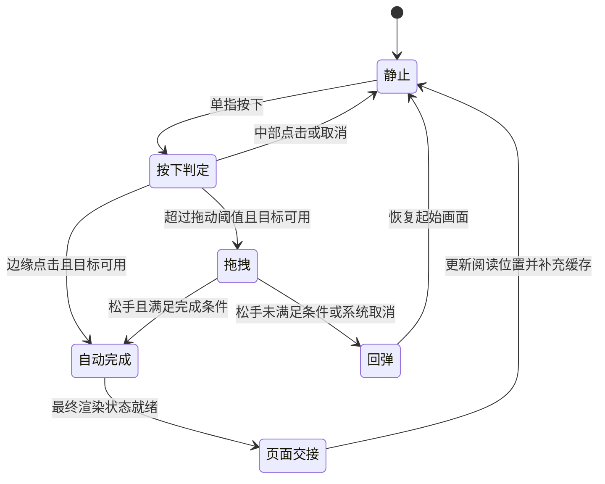
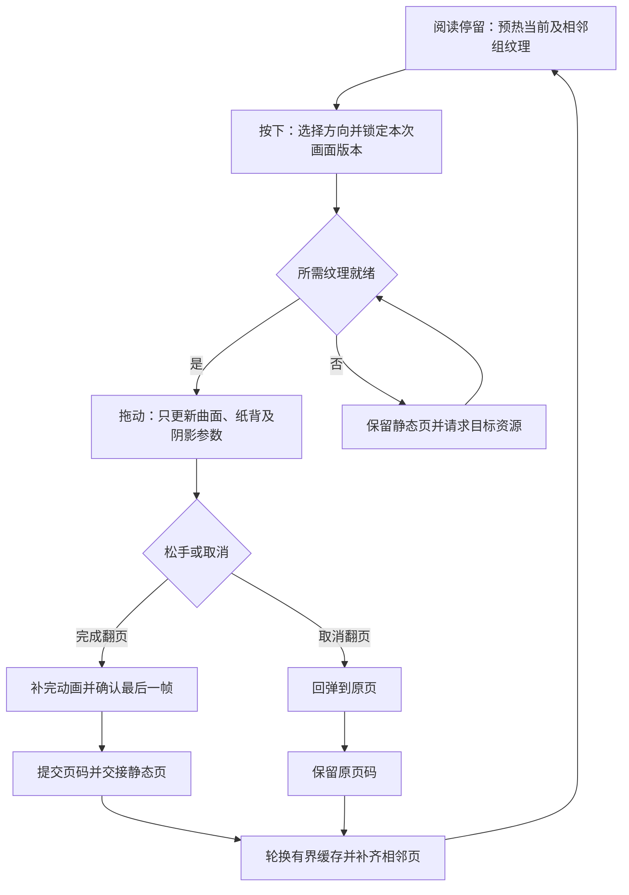

# 阅读器仿真翻页成熟流程调研

调研日期：2026-10-29（Asia/Hong_Kong）
范围：公开官方文档与项目源码；未查看漫画正文或真实书籍截图；未安装、运行或测试第三方阅读器。此文件是调研结论，不代表当前项目已完成性能验收。下文将“源码事实”与“基于资料的工程建议”分开说明。

## 1. 结论

适合漫画与图片书籍的路线是：**内容先组成稳定的页面或跨页帧，预先准备纹理，再用独立手势状态机驱动 GPU 纸张变形，完成或回弹后统一交接页面状态。** 圆柱模型是有公开实现依据的实用选择；不必以复杂纸张有限元或布料物理作为起点。该结论综合 PageFlip、harism 的几何实现，以及 StPageFlip 和 UIKit 的导航生命周期，属于本项目工程建议。[PageFlip](https://github.com/eschao/android-PageFlip)、[harism 设计说明](https://github.com/harism/android-pagecurl/blob/master/README.md)、[StPageFlip 状态与提交](https://github.com/Nodlik/StPageFlip/blob/master/src/Flip/Flip.ts)、[UIKit page curl](https://developer.apple.com/documentation/uikit/uipageviewcontroller/transitionstyle-swift.enum/pagecurl)。

“成熟”应同时衡量手指跟随、内容准备、正反面语义、取消回弹、双页和 RTL、末帧交接、资源重建；仅有卷曲动画示例不足以证明这些要求已经满足。

## 2. 可核查的参考实现

| 参考 | 已核查的能力和机制 | 在本项目中的用途与边界 |
| --- | --- | --- |
| Android PageFlip / eschao | OpenGL ES 2.0；半圆柱卷曲；可调网格、卷曲半径相关比例、纸背遮罩和阴影；单页/自动双页 | 原生卷曲算法与纹理角色的主要参考。属于翻页库和样例，不能直接视作完整阅读器或 HarmonyOS 组件。[README](https://github.com/eschao/android-PageFlip) |
| android-pagecurl / harism | 圆柱卷曲；按卷曲位置动态切分矩形、三角带渲染；正反面可设置不同纹理；单页/双页 | 适合研究低几何复杂度、拖拽约束和网格复用。其实现使用较早的 OpenGL ES 接口，移植应保留算法思路并适配当前渲染生命周期。[README](https://github.com/harism/android-pagecurl/blob/master/README.md)、[CurlMesh](https://github.com/harism/android-pagecurl/blob/master/src/fi/harism/curl/CurlMesh.java) |
| StPageFlip / Nodlik | Canvas 图片或 HTML；清晰的翻页状态；软页裁剪旋转、阴影；HTML 硬页 rotateY；单页/双页集合 | 适合参考交互和页面集合组织。已核查软页代码并非 GPU 圆柱曲面，不应作为同一种几何算法描述。[FlipCalculation](https://github.com/Nodlik/StPageFlip/blob/master/src/Flip/FlipCalculation.ts)、[HTMLPage](https://github.com/Nodlik/StPageFlip/blob/master/src/Page/HTMLPage.ts)、[ImagePage](https://github.com/Nodlik/StPageFlip/blob/master/src/Page/ImagePage.ts) |
| UIKit UIPageViewController | 官方 pageCurl；提供数据源时手势动画跟随手指；提供中间书脊、双面页面及手势过渡完成回调 | 是成熟行为契约的参照，可验证“前后页由数据源提供、动画由容器管理”。公开文档没有给出 Apple Books 的内部几何算法；UIKit 也不能直接用于 HarmonyOS。[pageCurl](https://developer.apple.com/documentation/uikit/uipageviewcontroller/transitionstyle-swift.enum/pagecurl)、[容器设计](https://developer.apple.com/library/archive/documentation/WindowsViews/Conceptual/ViewControllerCatalog/Chapters/PageViewControllers.html) |
| Readium | Navigator 统一阅读位置、前后导航与阅读方向；宿主负责菜单和额外交互；可重排 EPUB 使用稳定位置而非固定屏幕页码 | 主要参考内容导航与交互边界；不能据此声称其通用 Navigator 提供了圆柱仿真翻页。[Navigator 架构](https://github.com/readium/architecture/blob/master/navigator/public-api.md)、[Swift Navigator 指南](https://github.com/readium/swift-toolkit/blob/develop/docs/Guides/Navigator/Navigator.md) |
| KOReader | 已核查 ReaderView 在设备能力和设置允许时，向 Screen 设置 swipe animation 和方向 | 属于设备屏幕更新能力的适配实例，不能把“page turn animation”名称直接等同于本项目的 GPU 纸张卷曲。[ReaderView](https://github.com/koreader/koreader/blob/master/frontend/apps/reader/modules/readerview.lua) |

调研边界：本次打开的 Legado 官方仓库主分支仅有公告；旧仿真翻页类路径无法获取，不能据此确认其当前算法、许可或维护状态，也未以第三方镜像冒充官方源码。[官方仓库](https://github.com/gedoor/legado)。FBReader 未在本轮取得足以支持具体卷曲流程的官方源码证据，因此未列入算法对照。

## 3. 一次翻页的完整流程

以下是面向本项目的推荐流程，综合公开实现后加入异步内容准备和渲染确认边界，并非某一个库原样提供的状态机。



### 3.1 准备页面，再接受会暴露该页面的翻页

- 页面层产生当前帧与相邻帧；纹理层准备前面、背面和底页需要的图像。手势与渲染层只引用这些稳定资源，不在每次 move 中重新下载、排版或解码。
- PageFlip 样例区分静止整页、拖动帧和自动动画帧，并检查纹理是否已设置；下一页纹理准备完成后可在翻页结束时复用为当前纹理。这证明了“纹理角色复用”的模式，但样例在绘制阶段按需生成内容，不等于已解决网络漫画的异步首帧等待。[SinglePageRender](https://github.com/eschao/android-PageFlip/blob/master/Sample/src/main/java/com/eschao/android/widget/sample/pageflip/SinglePageRender.java)
- 工程建议：把目标帧的准备前移；若目标尚未就绪，明确等待、保持当前页或展示既定加载反馈，避免翻到一半临时换成另一页。

### 3.2 按下时确定方向、活动纸页和约束

按下时应记录起点、活动指针、上/下角或侧边、当前阅读方向；把“前进/后退”映射为屏幕左/右。双页模式中，触摸发生在哪一半决定活动纸页，另一半留在书脊处。PageFlip 的 `onFingerDown` 会将被触摸的一页置为活动页，随后在超过水平位移阈值后进入前翻或后翻。[PageFlip 手势实现](https://github.com/eschao/android-PageFlip/blob/master/PageFlip/src/main/java/com/eschao/android/widget/pageflip/PageFlip.java)

阈值值域是产品调参，不能把样例中的屏宽比例、毫秒数直接称为行业标准。缩放、文本选择、长按、菜单与横向翻页的优先级也需由宿主明确；多指缩放不应继续作为同一次翻页拖动。

### 3.3 拖动时由实时坐标驱动纸张形态

拖拽阶段输入的是手指当前位置，不是固定时长动画的时间进度。需要计算卷曲轴方向、位置、半径，以及纸边不能脱离书脊的几何约束。harism 将手势操纵放在 CurlView、几何和渲染放在 CurlMesh；代码约束卷曲轴，防止页面从书脊脱离。[CurlView](https://github.com/harism/android-pagecurl/blob/master/src/fi/harism/curl/CurlView.java)

工程建议：手势事件只更新最新参数；显示帧读取最近一次参数。不要把每个高频 move 事件都排入不可撤销的渲染队列，否则画面可能滞后于手指。

### 3.4 松手决定完成或回弹，沿同一几何路径收尾

StPageFlip 的 `stopMove()` 根据当前位置选完成目标或恢复目标；动画完成回调仅在 `isTurned` 时执行前后页切换，再清理翻动页和阴影。[Flip.ts](https://github.com/Nodlik/StPageFlip/blob/master/src/Flip/Flip.ts)

工程建议：完成判定可组合位移、朝向和速度，参数按实机手感确定；系统取消默认回弹。不要把抬手直接等同于换页。旧示例的策略不统一，例如 harism 将 `ACTION_CANCEL` 和 `ACTION_UP` 放在同一分支，移植时需重新确认取消语义。

### 3.5 页面交接与阅读进度只走一次

成功收尾后，交换当前/目标资源角色，更新阅读位置和进度，补齐下一组邻页。回弹保持原位置。UIKit 专门区分动画结束通知与 `transitionCompleted`，这类契约可以帮助避免将“动画结束”误认为“导航成功”。[UIKit delegate](https://developer.apple.com/documentation/uikit/uipageviewcontrollerdelegate)

工程建议：异步加载、窗口重建和跨章请求携带页面标识及版本；只接受仍属于当前导航事务的结果。末帧与新静态页面必须使用相同裁剪、缩放、背景和位置；需要对齐渲染确认后再撤下动画表面，防止出现一帧黑底、旧页或尺寸跳变。此项是针对异步阅读器的合成建议，不是对上述 demo 已具备这些机制的断言。

## 4. 几何路线怎样选

| 路线 | 实际效果与成本 | 本项目判断 |
| --- | --- | --- |
| 2D 裁剪、镜像/旋转、渐变阴影 | 可以表现折页和软页视觉；实现与调试较直接；页面内容仍按平面变换处理 | 可作为低成本模式或原型。StPageFlip 的软页源码属于这类。[软页计算](https://github.com/Nodlik/StPageFlip/blob/master/src/Flip/FlipCalculation.ts) |
| 圆柱/半圆柱曲面 + GPU 纹理网格 | 把卷曲区域映射到曲面，纹理随纸张弯曲；半径、轴线和拖动位置可控 | 适合原生漫画仿真翻页；PageFlip 与 harism 都提供公开依据。[PageFlip 参数说明](https://github.com/eschao/android-PageFlip)、[harism 设计](https://github.com/harism/android-pagecurl/blob/master/README.md) |
| 圆锥或更复杂物理模型 | 可增加形态自由度，也增加边缘约束、稳定性和性能调试成本 | 本轮没有取得足够的一手资料证明它是成熟阅读器的必选项，不建议仅为“更仿真”更换现有模型 |

网格细度不是越高越好。PageFlip 明确说明更细网格会降低性能；harism 则把更多顶点分配给弯曲区域，减少同一平面上的多余切分。优先核对纸边、曲率与 UV 连续性，再按测量决定细分。[PageFlip 网格配置](https://github.com/eschao/android-PageFlip)、[CurlMesh](https://github.com/harism/android-pagecurl/blob/master/src/fi/harism/curl/CurlMesh.java)

## 5. 漫画、文本书籍、双页和 RTL 的区别

| 内容/模式 | 页面生产与身份 | 翻页需要注意 |
| --- | --- | --- |
| 单页漫画、图片 EPUB/CBZ | 原图经缩放、裁剪、背景合成成为视口帧；保留原始图片身份 | 翻的是纸页或帧；纸背可使用约定纸色或透印效果，但不应随意拿后一张漫画作为背面 |
| 文本 EPUB/TXT | 先按字体、字号、行距、边距和视口完成分页，再提供该页渲染结果 | 排版变化会改变屏幕页码；用段落/字符定位或格式内 locator 恢复阅读位置。Readium 明确区分稳定 position 与屏幕页。[Readium 指南](https://github.com/readium/swift-toolkit/blob/develop/docs/Guides/Navigator/Navigator.md) |
| 双页漫画/书籍 | 当前跨页、翻动纸张正面、背面、底层跨页各有角色 | 以书脊为轴翻一张叶片；不要将整幅左右两页一并当作硬板旋转。双页 PageFlip 样例分别配置当前面、背面和下一底页内容。[DoublePagesRender](https://github.com/eschao/android-PageFlip/blob/master/Sample/src/main/java/com/eschao/android/widget/sample/pageflip/DoublePagesRender.java) |
| RTL | 阅读顺序与屏幕位置分别建模 | `forward/backward` 是阅读语义，`left/right` 是视觉操作；统一映射，避免各层重复反转。Readium 专门区分这两组接口。[Navigator public API](https://github.com/readium/architecture/blob/master/navigator/public-api.md) |
| 连续长条漫画 | 本质是纵向连续内容，原图长度可能远超视口 | 若启用翻页，应先明确“按视口分段”或“按整图切换”的产品语义；不要因特效强制把任意长图当作等高纸页。此为本项目设计建议 |

UIKit 的官方接口也把 `spineLocation`、`isDoubleSided` 与需要提供的页面数量关联，说明书脊和纸背是数据契约的一部分，而不只是着色器上的颜色设置。[setViewControllers 参数表](https://developer.apple.com/documentation/uikit/uipageviewcontroller/setviewcontrollers(_:direction:animated:completion:))

## 6. 性能与资源流程

以下是从公开实现与平台性能指南整理的建议，具体收益必须实机测量：

1. **分清缓存层。** 网络/文件缓存保存内容；解码缓存保存像素；页面帧缓存保存当前布局结果；GPU 缓存保存纹理。磁盘上已经缓存图片，不代表第一次翻动时已完成 GPU 上传。
2. **在空闲时预备邻页纹理。** Android 官方指出首次 Bitmap 上传可能消耗数毫秒，且图像不应远大于实际显示区域。该原理可用于排查 HarmonyOS 首翻卡顿；Android `prepareToDraw()` API 本身不能直接照搬。[Bitmap uploads](https://developer.android.com/topic/performance/issues/render)
3. **拖动期间只更新必要数据。** 复用网格与缓冲，尽量减少临时分配；harism 的 CurlMesh 预分配工作数组与顶点缓冲以减少运行时分配。[CurlMesh](https://github.com/harism/android-pagecurl/blob/master/src/fi/harism/curl/CurlMesh.java)
4. **减少同步 GPU→CPU→GPU 往返。** Arm 指南将同步读回列为图形流水线停顿来源；如必须读回，应评估异步读回、延迟消费与显式同步，而不是读回后立即等待使用。能在 GPU 内直接生成/组合目标纹理时，优先评估该路径。[Arm 优化指南](https://developer.arm.com/-/media/Files/pdf/graphics-and-multimedia/Guides/DUI0555C_mali_optimization_guide.pdf)、[Arm 异步读回说明](https://developer.arm.com/community/arm-community-blogs/b/mobile-graphics-and-gaming-blog/posts/it-s-just-criminal-examples-of-performance-thrown-away-in-real-apps-part-2)
5. **静止时不持续空转。** PageFlip 与 harism 都使用按需请求绘制；只在拖动和自动收尾期间推进帧。[PageFlipView](https://github.com/eschao/android-PageFlip/blob/master/Sample/src/main/java/com/eschao/android/widget/sample/pageflip/PageFlipView.java)、[CurlView](https://github.com/harism/android-pagecurl/blob/master/src/fi/harism/curl/CurlView.java)
6. **资源随 Surface 和布局代次重建。** 窗口尺寸改变要重算页矩形和目标纹理尺寸；上下文重建后旧纹理 ID 不能继续使用。harism 在 Surface 重建时清除旧纹理状态。[CurlView](https://github.com/harism/android-pagecurl/blob/master/src/fi/harism/curl/CurlView.java)

建议采集触摸到首个可见卷曲帧、目标纹理准备、帧间隔、末帧到静态页交接、CPU/像素/GPU 内存占用。以实际屏幕刷新率计算帧预算：60 Hz 约 16.7 ms，120 Hz 约 8.3 ms；不把任意一个设备的帧率结果泛化。Android 官方性能文档可作为指标解释参考，HarmonyOS 需使用其实际帧调度与测量工具。[Slow rendering](https://developer.android.com/topic/performance/vitals/render)

## 7. 从示例到可长期使用的阅读器还缺什么

- 内容生产不能依赖 demo 的内置位图：必须处理加载中、损坏图片、跨章、重试与快速反向翻页。
- 并发策略要明确：harism 当前示例动画期间不接受拖动；StPageFlip 可以先结束既有动画再开始新的点击翻页。这是不同策略，不存在已核查的统一标准。[CurlView](https://github.com/harism/android-pagecurl/blob/master/src/fi/harism/curl/CurlView.java)、[Flip.ts](https://github.com/Nodlik/StPageFlip/blob/master/src/Flip/Flip.ts)
- 保留返回、缩放、方向切换、后台恢复、无动画模式和无障碍路径；Readium 架构明确要求用户无障碍设置可以覆盖动画请求。[Readium 架构](https://github.com/readium/architecture/blob/master/navigator/public-api.md)
- 验收需覆盖单页/双页、前后翻、RTL、章节边界、奇数尾页、缓存命中/未命中、拖动取消、连续点击、旋转与 Surface 恢复。这里列的是后续验收范围，本轮未执行测试。

## 8. 复用许可与资料边界

- PageFlip 声明 Apache-2.0；harism 源码也声明 Apache-2.0，但 NOTICE 明确将 demo 图片和应用图标列为例外。借鉴算法或代码时需保留适用声明，不应将样例视觉资产直接纳入产品。[PageFlip LICENSE](https://github.com/eschao/android-PageFlip/blob/master/LICENSE)、[harism NOTICE](https://github.com/harism/android-pagecurl/blob/master/NOTICE)
- StPageFlip 为 MIT；具体复用应保留许可证要求的声明。[LICENSE](https://github.com/Nodlik/StPageFlip/blob/master/LICENSE)
- 此次仅核对可访问的主分支和文档；未固定第三方源码提交，也未评估所有未解决 issue。正式移植前应固定所采纳提交，并对相关源码文件及依赖单独核对许可。
- 未取得 Kindle、微信读书、掌阅或 Apple Books 的内部翻页源码，不推断这些产品使用的具体纸张算法。UIKit 官方能力只作为公开行为契约引用。


## 9. HS_mihon 当前实现对照（2026-10-29 源码静态核查）

本节核查当前工作区源码和现有交接记录，仅作架构对照。没有修改阅读器源码，没有重新构建、运行测试或连接设备；历史实验结果不构成本轮性能实测。

### 9.1 已有的正确骨架

| 责任 | 当前入口 | 核实结果 |
|---|---|---|
| 有界页面窗口 | [PagerWindow.ets](../entry/src/main/ets/reader/PagerWindow.ets) | 当前组及前后相邻组，通常最多三组；双页组最多两张图片。不是预取多少原图就常驻多少纹理。 |
| 快照及纹理身份 | [HorizontalPager.ets](../entry/src/main/ets/ui/HorizontalPager.ets) 的 `frameKey`、`capture`、`captureFrame` | 帧键包含视口代次、页槽、绘制修订和局部位置；整条截图/上传工作以帧键去重，过期异步结果有身份检查。 |
| 指针到曲面 | [CurlGesture.ets](../entry/src/main/ets/reader/CurlGesture.ets)、[CurlGeometry.cpp](../entry/src/main/cpp/CurlGeometry.cpp)、[CurlShaders.h](../entry/src/main/cpp/CurlShaders.h) | 已有按角点、手指纵坐标、位移、速度计算卷曲的圆柱模型；顶点着色器投影网格。当前不是只有整页平移或平面旋转。 |
| 单页/双页纸背 | [CurlShaders.h](../entry/src/main/cpp/CurlShaders.h) | 单页使用不透明纸背；双页背面从新跨页组的接收半页取样，并处理方向，避免把漫画文字镜像当成另一面。 |
| 补完、回弹、交接 | [HorizontalPager.ets](../entry/src/main/ets/ui/HorizontalPager.ets) 的 `settle` | 等原生末帧交换序号确认后才提交新页码，之后保留 GPU 画面跨两次 ArkUI 帧回调再清除覆盖层。这个确认不是物理屏幕扫描完成证明。 |
| 解码调度 | [DecodeScheduler.ets](../entry/src/main/ets/image/DecodeScheduler.ets) | 当前正式默认为 4 路；可见页及请求目标优先，预热新启动任务最多 1 路。旧记录中的 1/2 路不是当前正式默认。 |

当前初始网格是 **160×96**，原生帧耗时累计触发后可降至 96×64、64×40；本轮没有实施 80×48，也未评估其设备表现。

### 9.2 当前等待出在哪里

```text
文件/缓存可用
  → 分块解码、布局与可见块绘制完成
  → 组件截图（waitUntilRenderFinished: true）
  → PixelMap ReadPixels 到 CPU 缓冲
  → 分配第二缓冲，逐像素复制/转换
  → EGL 线程 glTexImage2D 上传
  → 当前页和目标页纹理均就绪
  → 才能进入有效曲面拖动或点击动画
```

源码位置：`HorizontalPager.ets` 的 `prepareCurl` / `captureFrame` / `dragTo` / `settle`，以及 [CurlRenderer.cpp](../entry/src/main/cpp/CurlRenderer.cpp) 的 `CacheExecute` / `UploadTexture` / `Run`。

这里使用的是 `OH_PixelmapNative_ReadPixels` 图像接口，不是 OpenGL `glReadPixels`。不能仅凭函数名相似，将 Arm 对同步 GPU 读回的说明直接当作本项目发生 GPU 同步停顿的证据；实际存储和同步成本仍需测量。

- `dragTo` 在目标画面未完整时把位移归零；画面完整但纹理未就绪时显示“正在准备翻页纹理…”。`settle` 对同类条件显示“正在准备翻页画面…”。因此命中文件缓存仍可能等待。
- 当前 `CacheExecute` 即使收到紧密排列的 RGBA，也分配第二个缓冲再逐像素复制；源读取缓冲在等待原生 Cache 返回期间仍存活。这是值得单独优化的复制和内存占用路径。
- 原生 `Run` 会先清空上传队列再绘制下一帧。低优先级预热上传与正在交互的绘制共享 EGL 线程，可能影响响应；本轮没有测量此影响的大小。

现有 [交接第 11.5 节](HANDOFF-reader-scroll-curl-2026-10-28.md) 保存的旧 2 路实验中，读取缓冲及 ReadPixels 每组累计均值约 53.5–60.9 ms，上传缓冲及转换/复制约 59.6–66.3 ms，上传约 23.3–26.0 ms。它们是历史阶段累计均值，跨线程可能重叠，不能直接相加为单次等待，也不是当前正式 4 路版本重新测得的成绩。该记录支持继续检查像素准备路径，不证明任一具体方案的加速倍数。

### 9.3 建议采用的流程和模块边界

下面是结合公开实现和本项目现状提出的工程方案，不声称每个参考库都完整实现了它：



建议维持以下责任分工：

1. **页面内容与布局层**提供不可变视口描述：页身份、单/双页、LTR/RTL、缩放裁剪、长图局部位置、背景、书脊与外侧留白。文字书先排版分页；漫画走图像解码/分块。两种内容可以共享翻页控制与曲面渲染。
2. **页面画面合成层**把视口描述和受引用保护的图像分块合成为离屏纹理；为每个版本发布真实的 TextureReady。静态显示和卷曲画面必须使用相同布局规则。
3. **翻页控制层**管理输入、完成/回弹、页码提交和取消。热路径只读已准备资源并提交最新参数；不在每次手指移动中排版、截图、读像素或上传。
4. **原生渲染层**拥有 GPU 资源、曲面和阴影，优先响应活动翻页；相邻页上传受优先级和帧预算约束。本次手势使用的画面版本固定到交接结束。

这些职责可以在现有模块中逐步收敛，不需要先更换阅读器框架或创建整套新引擎。冷启动、旋转、缩放导致的资源失效仍需真实准备，不能承诺任何条件下都零等待。

### 9.4 适合当前项目的落地顺序

| 顺序 | 建议 | 目的与边界 |
|---|---|---|
| 1 | 先区分紧密 RGBA、带 stride 的 RGBA 和 BGRA；分别评估读取缓冲移动、按行复制、批量通道转换 | 先减少现有路径的一次副本和标量循环；ReadPixels 本身仍搬运数据，不能称为零拷贝。格式比例和收益需要设备计时。 |
| 2 | 将当前/用户请求目标纹理置于预热之前；活动翻页时避免无预算地连续清空后台上传队列 | 保护输入到首个有效曲面的响应。GL 上传和绘制如何交错必须在同一上下文的约束下实现和测量。 |
| 3 | 复用已解码分块，按相同视口规则直接合成卷页纹理 | 减少组件树快照栅栏、CPU 读取和重复转换的机会；是否能共享底层图像/GPU 资源取决于目标 API24/26 能力，当前尚未验证。 |
| 4 | 在绘制阶段确有瓶颈时再评估较低或自适应网格 | 网格减少主要影响曲面每帧工作量，不能直接消除截图、读取、复制、上传阶段的冷准备等待。 |
| 5 | 必要时再评估两级清晰度 | 小纹理先准备、空闲升级；一次手势内锁定版本。需单独评估漫画线条和文字的清晰度，不默认降低静态阅读质量。 |

三组缓存是本项目当前窗口设计，不是所有阅读器的统一标准。缓存应按字节预算和页方向管理，而非无上限增加数量。以每张 2048×1536 的 RGBA 纹理为例，一张约 12 MiB，三张 CPU 画面加三张 GPU 纹理约 72 MiB，尚未计入解码分块、读取/上传中间缓冲和界面资源；这只是尺寸计算，不是当前设备内存实测。

后续若实施，应分别比较冷进入、预热后连续翻页、立即反向、双页末尾单叶、RTL、长图局部位置、旋转/缩放后的首帧及交接，使用自有合成图片即可。按项目最小验证原则，只在具体核心变更落地时选择相关检查；本轮没有启动这些验证。
