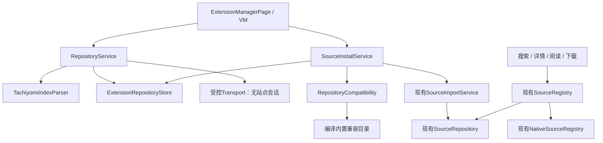

# Mihon式漫画源仓库导入实施方案

> 2026-10-28 实施进展和下一会话入口见 [漫画源交接](HANDOFF-source-integration-2026-10-28.md)。本文件保留原设计，未完成的计划项不代表已实现。

制定日期：2026-10-27，Asia/Hong_Kong。项目基线：当前源码0.8.6/code17，ArkTS/ArkUI、API26编译与目标、min API24、阅读数据库schema6。

本文是待实施方案。已完成项目源码及公开索引核对；尚未实现仓库导入，不代表其中任何新源已可用。建议作为0.9.x功能线，具体发布版本在开发时确定。

## 1. 实施结论与范围

推荐沿用项目现有两种执行方式：**原生适配器 + 受限JSON/HTML规则**，在它们上方增加“扩展仓库目录、兼容性解析、安装编排”。用户可粘贴指定仓库地址，查看扩展、筛选、安装可用实现、检查更新、启停和移除。

用户给出的[index.min.json](https://raw.githubusercontent.com/LittleSurvival/copymanga-copy20/repo/index.min.json)是Android扩展目录，不是本项目的抓取规则。目录提供包名、版本、APK文件名及源的身份信息，没有搜索请求、字段提取、章节解析或图片解码实现。

Mihon官方[ExtensionLoader](https://github.com/mihonapp/mihon/blob/main/app/src/main/java/eu/kanade/tachiyomi/extension/util/ExtensionLoader.kt)依赖Android包信息、签名检查和类加载器，再实例化Source/SourceFactory。由此结合本项目当前执行链路判断：下载APK、解压DEX或读取其中的JSON，均不能让这些扩展直接成为可执行的ArkTS源。实现APK通用运行环境会成为另一个独立工程。

本方案的兼容承诺分为三层：

| 层级 | 达成内容 | 可以宣称的结果 |
|---|---|---|
| 目录兼容 | 接受指定传统JSON索引，管理仓库及其扩展记录 | 已导入仓库，可浏览扩展 |
| 安装兼容 | 找到经过维护的本项目原生实现或规则包，并完成关联/激活 | 已关联内置实现，或已安装规则 |
| 运行验收 | 在真实环境完成搜索、详情、目录、图像及离线链路 | 此源在记录的环境和样本范围内可用 |

首期兼容格式明确命名为`tachiyomi-json-v1`，只指本文给定的传统索引。Mihon官方[变更记录](https://github.com/mihonapp/mihon/blob/main/CHANGELOG.md)已包含其他扩展及索引格式，因此不能将本功能命名为“兼容所有Mihon仓库”。遇到其他格式显示“不支持的目录格式”，后续再增加解析Adapter。

最终目标仍是让用户通过仓库管理和安装可用漫画源；只有目录界面的交付属于第一阶段，不能作为整项功能完成。

## 2. 项目现状及复用点

以下路径均相对项目根目录`E:\AI_coding\HS_mihon`，已在本次直接核对。

| 文件/模块 | 当前能力 | 本方案处理 |
|---|---|---|
| `model/SourceTypes.ets`（位于entry/src/main/ets下） | Source提供search/details/chapters/pages/resolveImage；discovery可选 | 保持执行Interface稳定，仓库模型不进入阅读器 |
| `source/SourceRegistry.ets` | 原生/规则统一打开，revision检查，下载固定快照，取消与变更隔离 | 全部新规则继续通过这里执行 |
| `source/SourceImportService.ets` | 预览、摘要、同版本内容冲突、版本递增、域名差异、激活、启停、回滚、软移除 | 安装规则唯一入口，不另写激活逻辑 |
| `storage/SourceRepository.ets` | 不可变规则文件、摘要寻址、catalog原子切换、并发revision | 保持格式及存储职责；不存仓库目录 |
| `source/RuleSubscriptionService.ets` | HTTPS单规则URL下载、可选摘要、预览、记住订阅 | 保留高级单规则订阅，不把扩展数组交给它 |
| `source/rules/RuleValidator.ets` | 256KiB，四操作，匿名GET，统一JSON或HTML提取，有限转换 | 复用严格校验；不能把索引强转成规则 |
| `source/NativeSourceRegistry.ets` | 包子/COPY编译内置实现、启停、网址及版本快照 | 原生源关联使用稳定ID；代码更新随应用发布 |
| `source/SourceSiteService.ets` | 修改网站根地址、revision、恢复/回滚网址 | 目录baseUrl仅作提示，不自动修改当前网址 |
| `ui/BrowsePanel.ets`、`app/AppContainer.ets` | 聚合已安装源；按discover能力进入首页或搜索 | 保留已安装列表语义，新目录单独展示 |
| `pages/RuleManagerPage.ets`、`vm/RuleManagerVM.ets` | 本地/文本规则导入、单规则订阅、版本预览 | 保留为高级入口，不继续堆叠仓库逻辑 |
| `network/UrlPolicy.ets`、`RcpTransport.ets` | 精确HTTPS域名、响应限制、跳转、取消、系统TLS | 新仓库请求遵守同样限制，增加明确无站点会话选项 |
| `business/BackupService.ets` | 设置白名单；不备份规则、下载路径、凭据 | 首期保持原备份契约 |

现有限额必须计入安装预览：规则记录最多64项，包括已软移除记录；每源最多32个保留版本；规则正文256KiB。仓库里列出500项不等于安装500项，目录记录不能占用这64个执行源名额。

源码中已经存在单规则订阅；`docs/mihon-parity-progress.md`里M12仍标“待开发”，文档与代码不同步。开发时需按“单规则订阅已有代码、仓库目录尚缺”的实际状态更新，不能据此重复实现或推定真机验收通过。

## 3. 指定仓库分析与首批支持策略

2026-10-27通过网页工具观察到5个扩展，每项当前各含1个源。下表仅为当日索引事实及项目适配判断；名称相似不构成实现兼容证明。

| 上游源 | 扩展version/code | 外部source ID（字符串） | 本项目接入策略 |
|---|---|---|---|
| 拷贝漫画 | 1.4.85 / 85 | `6696312508930833206` | 已有`org.hsmihon.copy`，作为首个原生关联候选；先核对身份和支持范围 |
| vomic漫+ | 1.4.4 / 4 | `3001986353` | 尚无实现，需专项移植，先登记目录 |
| 包子漫画+ | 1.4.4 / 4 | `4654438345013653772` | 已有包子实现可评估复用，但不得直接等同 |
| 漫蛙2+ | 1.4.8 / 8 | `1506592945012434101` | 尚无实现，需专项移植 |
| 嬉皮漫畫 | 1.4.1 / 1 | `10879178251255350` | 尚无实现，需专项移植 |

数据来源：[用户指定索引](https://raw.githubusercontent.com/LittleSurvival/copymanga-copy20/repo/index.min.json)。这些版本只描述Android发布物，不能作为本项目适配器的已安装版本。

重要差异：索引中包子漫画+的baseUrl为`https://www.webmota.com/`，项目内置包子的默认网址为`https://www.twmanga.com/`。必须先核对搜索、详情、目录、remoteId及章节locator契约；如果不是同一身份体系，应建立独立的本项目源ID，通过现有迁移功能处理作品迁移，不能改写`org.hsmihon.baozi`的含义。

COPY也只认定“有可复用实现”，不承诺具备上游APK全部功能。上游[仓库说明](https://github.com/LittleSurvival/copymanga-copy20/tree/repo)提到部分账号、线路及筛选能力；本项目有原生网页实现，不等于这些APK能力已移植。vomic的账号要求是调研线索，实际权限与请求契约需实施时重新核对。

原生关联条件是维护者显式登记的`仓库身份 + pkg + 外部sourceId`三元组，加上已审查的支持范围。禁止根据显示名称、baseUrl相同、pkg后缀相似自动匹配。未完成审查的项目显示“待适配”，不显示“安装成功”。

## 4. 用户操作流程

保留书架、更新、历史、浏览、更多五个主入口。在浏览顶部增加“扩展”入口，进入一个新的`ExtensionManagerPage`，页内包含“扩展”和“仓库”两个区域；已安装源仍由原BrowsePanel展示。现有“源规则”继续用于本地规则和单规则订阅。

### 4.1 添加仓库

1. 用户粘贴完整HTTPS `index.min.json`或`index.json`地址。
2. 规范化并下载目录，解析出扩展和子源；仅预览，不立即安装任何源。
3. 同目录可选读取`repo.json`，展示仓库名、网址及自述签名指纹；缺失该文件不阻止传统索引导入。
4. 展示目录URL、扩展数、源数、内容分类及适配数量。仓库信息来自该URL，不代表发布者身份已独立验证。
5. 用户保存后写入独立仓库目录。相同规范化URL再次添加时打开已有仓库。
6. 首次加载失败保留输入供重试；刷新失败保留上次成功列表并标记时间和错误。

首期只支持完整原始索引URL。GitHub网页地址、仓库主页和一键scheme跳转可作为后续便利功能，避免首期引入不透明URL猜测。

### 4.2 浏览与安装

扩展列表按包分组，展开后显示sources子项，支持名称搜索、语言、仓库、可安装/已安装/待适配筛选。单个APK可能提供多个源，不能把包和源建成一对一模型。

- 原生候选通过审查后，按钮为“关联内置源”；已存在的源显示“使用内置实现”。只建立来源关联，不下载APK、不新增重复Source。原先禁用的源保持禁用，可单独启用。
- 规则实现可用时，按钮为“安装规则”。预览本项目源ID、规则版本、域名变化、规则摘要及来源，再调用现有激活流程。
- 仅有APK而没有本项目实现时，显示“待适配”和原因；详情可打开项目说明网址，不能提供一个实际无效的安装按钮。
- 外部源ID、pkg和上游版本仅放在详情，主列表使用源名、适配状态和可执行操作。
- 首期不自动加载远程图标，使用现有字母图标；减少额外资源与域名依赖。后续可独立增加有界图标缓存。
- `nsfw`转换为目录内容分类；默认隐藏标记为成人或分类未知的远程条目，并提供明确筛选设置。该标签不自动修改已存在原生源的显示/启用状态。分类字段异常不按安全内容处理。

### 4.3 更新与移除

“检查更新”先刷新目录并计算差异，分别显示“上游扩展有更新”“本项目规则可更新”“原生实现需应用升级”。同包code增加不会自动激活规则或改变网站域名。

移除仓库仅停止该仓库的更新检查；保留已安装规则、关联来源记录、书架、阅读进度和离线文件。内置实现只能取消仓库关联或停用，不能展示成可卸载APK。规则移除调用现有软移除流程；既有SourceChanges负责中止相关在线请求，离线可读性按现有实现保留并专项核查。

## 5. 模块设计与依赖方向



仓库管理Module负责地址、目录下载、校验、缓存、差异及来源身份；安装Module负责目标解析、预览、来源冲突和跨存储恢复。解析Adapter只做外部JSON到内部模型的转换。阅读Module不知道仓库URL或APK名称。

现阶段没有两种目录格式实际需求，不先创建通用插件运行框架。保留`RepositoryFormat`字段和明确解析入口；第二种格式真正接入时再提取公共Interface。现有`Source`就是原生与规则Adapter的共同接入位置，不再增加一套运行时注册器。

建议的对外Interface如下，具体类型使用显式ArkTS模型，不以`any`或不可信对象断言代替校验：

```text
RepositoryService
  previewAdd(indexUrl, context) -> RepositoryPreview
  save(preview) -> RepositoryRecord
  refresh(repoId, expectedRevision, context) -> RepositoryRefreshResult
  list() -> RepositoryView[]
  remove(repoId, expectedRevision) -> void

SourceInstallService
  preview(selection, context) -> SourceInstallPreview
  apply(preview) -> SourceInstallResult
```

这些Interface还必须约定：超时与取消、最大响应、预览有效期、revision冲突、来源冲突以及可恢复的部分完成状态。`save/apply`不信任可变VM对象，必须重新验证输入和持久化快照，沿用现有导入设计。

## 6. 数据模型、身份和持久化

### 6.1 四类记录

| 记录 | 核心字段 | 不变量 |
|---|---|---|
| RepositoryRecord | id、format、indexUrl、revision、snapshotDigest、checkedAt、successfulAt、removed、meta | id由规范化索引URL的SHA256生成；URL变更不能悄悄继承旧来源 |
| IndexedExtension | repoId、pkg、name、lang、versionName、versionCode、apkFile、contentRating、sources[] | 包身份为(repoId,pkg)，APK是目录信息 |
| IndexedSource | externalId、name、lang、baseUrl | externalId全程字符串，不作为本项目sourceId |
| SourceBinding | repoId、pkg、externalId、localSourceId、kind、implementationVersion、installedDigest、observedUpstreamCode、originStatus | 三元组到本项目稳定ID的显式映射，带来源归属 |

额外保留`InstallIntent`用于规则激活的异常恢复；兼容目录项具有`mappingRevision`、`reviewedUpstreamCode`与兼容范围。catalog中的字段名用显式协议编码，避免Release属性混淆改变落盘格式。

例如COPY的候选兼容项可按下列本项目结构描述；`pending_review`必须在审核后才能改成可关联状态。这是新设计的数据结构，不是上游已提供的规则：

```json
{
  "repositoryIndexUrl": "https://raw.githubusercontent.com/LittleSurvival/copymanga-copy20/repo/index.min.json",
  "pkg": "eu.kanade.tachiyomi.extension.zh.copymanga",
  "externalSourceId": "6696312508930833206",
  "localSourceId": "org.hsmihon.copy",
  "kind": "native",
  "implementationVersion": 1,
  "targetUpstreamCode": 85,
  "status": "pending_review"
}
```

该示例的85是拟审核目标；正式记录中的`reviewedUpstreamCode`仅在审核完成后写入。

三类版本必须分别记录：

- `versionCode`：Android扩展包版本，例如COPY的85；比较时仅限同仓库同pkg。
- `implementationVersion`：本项目规则sourceVersion或编译内置Adapter版本。
- `revision`：本地状态变更计数，处理预览过期及并发。

`versionName`用于展示，不按字符串顺序判断更新。上游code更新只能触发“需复核上游变化”；要安装本项目规则更新，仍必须取得规则包、验证其sourceVersion和摘要。

### 6.2 64位ID处理

索引多个ID超过JavaScript安全整数范围。严禁`Number(id)`、`parseInt(id)`或经普通JSON数字转换后再转字符串。

复用`parsing/JsonExtractor.ets`：它保留数值词法，并拒绝重复JSON键。字符串ID保持原样；如兼容数值型ID，只接受非负十进制整数字面量并直接保存scalar文本，不接受小数/指数。内部键对三元组编码后摘要，不能简单无分隔拼接。

一个sourceId可能来自多个仓库。不得自动合并；本地执行源发生冲突时优先保留当前来源。切换发布来源必须单独预览确认，不能借“同ID更新”接管已有安装。

### 6.3 存储选择

首期使用独立私有文件namespace：

```text
filesDir/extension_repositories/catalog
filesDir/extension_repo_indexes/<sha256>
filesDir/source_rules/catalog              # 已存在，保持职责
filesDir/source_rules/<sha256>             # 已存在的不可变规则
```

复用FileStore提供的临时写入/切换方式，构建独立`ExtensionRepositoryStore`，包含全局revision与提交队列。FileStore的key有64字符限制，repoId和摘要适配该限制，不直接用URL或pkg当文件名。

目录快照先完整下载校验、计算摘要、写入不可变文件；最后切换catalog指针。写入失败保留旧目录。新catalog无法解码、schema过新时拒绝覆盖；残留无引用快照可在后续有界清理时删除。

首期不增加阅读数据库表，不升级schema6，不修改`manga.source_id`、章节ID、阅读记录或下载文件指针。仓库元数据的schemaVersion与阅读数据库schema独立管理。

## 7. 索引校验及地址规则

### 7.1 目录解析

上游字段分别解释为：name显示名，pkg扩展包身份，apk发布物文件名，lang扩展语言，code整数版本号，version展示版本，nsfw内容分类，sources子源列表。

解析器要求顶层数组；校验必填字段的类型、长度、pkg字符集、正整数code和sources列表。不将缺少apk/code/version的条目当成可安装项。未知附加元数据在大小/节点限额内可忽略并记录兼容提示，关键字段类型错误、重复pkg或包内重复source ID则拒绝整个新快照。

`sources[].baseUrl`只作目录元信息。不能由它产生allowedHosts、图片CDN权限、登录目标或网站设置。无效网站地址标记该子源信息不可用，不触发访问；不得影响旧已安装实现。

`apkFile`只接受安全文件名，拒绝斜杠、反斜杠、`..`、控制字符、查询及片段。仓库实有apk目录，但首期不请求APK。后续若仅需展示其地址，应由已知仓库根路径与安全文件名组合，不能接受任意远程可执行URL。

建议首期限额：最多20个仓库，每仓库索引1MiB、500个扩展、2000个子源、每包最多64个子源；同时受现有JSON解析器深度64/节点50000约束，以先触及者为准。字段限长按用途明确登记；不得通过简单提高全局解析上限支持大型仓库。扩大范围需另做性能评估。

空数组是合法空目录，展示“仓库当前无扩展”，不能据此卸载任何源。条目从目录消失仅标记“上游已下架”；继续保留已安装实现。

### 7.2 URL与请求

1. 只允许标准443端口HTTPS公网域名；拒绝凭据、片段及首期不需要的查询参数；清理输入两端空白。
2. 规范化scheme、hostname及默认端口；保留仓库路径、分支和文件名的大小写，不能对整个URL转小写。
3. `repo.json`只从同目录解析为可选元信息；其website不参与下载地址推导。404视为未提供，其他失败给出提示，不能把未校验内容标成可信元信息。
4. 首期仓库元数据和规则发布物使用直接URL，禁止自动跳转。服务端返回3xx时提示重新核对最终原始链接，不自动增加域名白名单。后续如果支持跳转，须逐跳校验已批准的origin和仓库路径范围。
5. 新增`RcpTransport`内部可选配置：仓库请求不读取/注入SiteSession Cookie、禁用自动重定向处理；默认配置保持既有漫画请求行为。Transport请求Interface及全局请求头白名单首期无需改变。
6. 每次操作遵守CallContext截止时间、取消及现有限流；初始总预算60秒，仓库并行最多2个。页面退出或重新添加时取消旧请求，迟到结果不能写入新预览。
7. 首期使用有界完整GET和内容摘要去重，不实现ETag/304。当前RcpTransport请求头白名单不支持条件头，不能在UI里绕过或放宽全局权限。
8. 保留系统证书验证及既有网络配置。UrlPolicy提供URL/域名限制，不能宣称已经解决DNS重绑定等全部网络风险。

## 8. 兼容目录与规则发布

### 8.1 第一批：随应用编译的显式兼容目录

新增`RepositoryCompatibility.ets`，只登记已审查的三元组及执行目标。初期COPY作为首个候选；包子+只有核对契约后才能登记。兼容项记录审核时观察到的上游code、本项目Adapter版本和功能范围。

上游code超出已审核范围时，已存在的本项目实现继续按其自身状态运行，目录关联显示“上游版本待复核”；新关联不伪装成最新APK的完整支持。远程索引不能修改这份编译内置目录。

原生关联不修改用户网站地址。索引地址变化可以提示“上游登记网址变化”，用户如需改站仍进入现有网址设置，按其预览与revision规则处理。

### 8.2 后续：本项目规则仓库

要让新增源真正做到“发布规则后用户安装，无需更新应用”，需要维护本项目自己的规则目录。上游没有提供本项目规则时，必须有维护者编写/移植；客户端无法从扩展索引补出请求逻辑。

建议后续增加独立`hs-rule-repo-v1`格式，目录项包含本项目sourceId、sourceVersion、规则相对路径、SHA256、engineMin/Max；可选记录关联的传统仓库三元组。规则正文仍完全遵守现有RuleValidator，不向正文塞入它不认识的仓库字段。

规则目录仅能声明自己的规则发布物；普通第三方目录不能自行声称可替代内置源或接管其他仓库源。跨origin发布先单独预览origin；首期可限定与规则目录同origin、同发布目录下且无跳转。

`repo.json.meta.signingKeyFingerprint`是上游提供的APK签名身份线索，不是规则文件SHA256，也不是对index的数字签名。规则摘要用于检查字节完整性；摘要和文件来自同一个未验证发布点，不能据此宣称发布者身份已验证。首期对用户添加的规则仓库实行显式来源确认、固定来源归属和权限预览；若产品要求离线可验证的发行者身份，应另加带公钥固定和独立签名的manifest协议后再宣称具备此能力。

默认规则更新仍由用户确认激活，不默默新增域名。引擎不支持的POST、混合JSON/HTML、登录流程、动态脚本或专有解码能力显示“不兼容”，再决定增加经过审查的原生Adapter或下一版有限规则能力。

## 9. 安装、更新、恢复状态

### 9.1 安装规则的完整步骤

1. 用户选择某个扩展子源，解析得到确定的本项目实现候选。
2. 固定仓库revision、目录摘要、兼容映射revision、外部三元组及目标sourceId。
3. 下载规则正文；限制256KiB并校验发布目录中的SHA256。
4. 调用`SourceImportService.preview(raw)`，同时核对sourceId、版本、来源归属、引擎、域名差异和现有配额。
5. 生成只读预览token，绑定以上身份、规则摘要和本地catalogRevision；有效期建议10分钟，用户可随时重新预览。
6. 用户确认时重新验证token、仓库与本地revision，先持久化InstallIntent，再调用`SourceImportService.activate`；实际启用状态沿用既有导入规则。
7. 写入SourceBinding并完成intent；显示安装结果，重新加载已安装源列表。

不要求一次跨仓库文件和规则文件完成不存在的全局事务。出现“规则激活成功但来源记录写入失败”，必须返回可恢复的部分完成结果，不能报告已回滚或假装全部失败。

启动/下次打开管理页时扫描有限数量的未完成intent：如果实际目标sourceId的active摘要正好等于intent摘要，补齐绑定；否则标记冲突待重新预览，不能擅自激活旧规则、覆盖新版本或切换发布来源。源级安装串行；跨页面仍由SourceImportService的catalog revision阻止旧预览覆盖。

### 9.2 状态维度

安装状态、适配状态、目录新旧和真实源健康状态分别保存/派生，不能用一个`installed=true`代替：

| 维度 | 示例 |
|---|---|
| 目录 | 最新、缓存、刷新失败、已下架 |
| 适配 | 内置可用实现、规则可安装、待适配、引擎不兼容、上游变更待复核 |
| 本地 | 未安装、已关联、已安装启用、已安装禁用、安装待恢复、来源冲突 |
| 运行记录 | 未验证、记录范围内通过、需登录、网络失败、解析失败 |

健康记录注明时间、应用/规则版本及验证环境；不能用仓库下载成功代替真实网站健康。安装目录可离线浏览缓存；没有经过完整性校验的规则正文时不提供离线安装成功。

### 9.3 回滚与原生快照

规则继续使用现有lastGood回滚，不因回滚重新下载APK。不同来源切换不走普通“版本更新”。软移除不清理用户书架和离线资产。

当前`NativeSourceRegistry`描述符及COPY实现版本为固定1，快照不能代表未来任意Adapter代码。实施规则：

- 建立明确的编译内置Adapter版本目录，NativeSourceRegistry描述符与实际Source.version使用同一值。
- 原生实现变动时快照摘要必须变化；不得只更新UI版本号。
- 现有原生下载固定快照只能在与当前实现/网址相符时继续。应用升级无法提供旧编译代码时，旧任务应明确暂停并提示重新入队，不能假定旧实现仍存在。
- 旧快照字段按兼容解码处理或明确判定需重新入队，不能把schema升级导致的差异误称文件损坏。原生代码回滚随应用发布策略处理，不提供虚假的“回滚APK”操作。

## 10. 五个源的实际移植路线

每个源先确认搜索/详情/章节/图像契约、稳定身份、会话需求、分页、CDN、内容解码及许可，再选择受限规则或原生Adapter。页面快照与合法的公开资料可辅助解析检查，但真实账号、TLS和解码仍需运行验收。

| 优先级 | 工作 | 完成门槛 |
|---|---|---|
| 1 | COPY现有原生实现与仓库三元组关联 | 关联不产生重复源，原书架ID不变；明确与Android扩展功能差异 |
| 2 | 包子+与现有包子源契约审查 | 有同源身份与路径依据才复用；不兼容则独立ID和Adapter |
| 3 | vomic专项调研及移植 | 确认账号流程后复用SecretStore/SiteSession隔离；目录导入不索要密码 |
| 4 | 漫蛙2+、嬉皮漫畫逐源调研 | 确认请求、图像与稳定ID后选择规则或原生实现，各自独立验收 |

2—4的具体顺序可按可取得的访问条件调整。未验证的接口、解码算法和账号条件不得在方案中补造；没有足够资料时保留“待适配”及缺失项，但整项最终验收仍要求完成承诺的源，而非永久只交付目录。

原生源需要新增时，先将NativeSourceRegistry中两源专用选择逻辑收敛为小型编译工厂目录；这是真正出现第三种实现后的必要扩展，不在首期重写整套SourceRegistry。新增源的ID、站点设置、域名和Adapter版本共同登记，不能让所有非包子源都落入COPY分支。

## 11. 文件级任务清单

以下源码路径均以`entry/src/main/ets/`为前缀。按阶段创建，避免一次铺设所有空抽象。

| 文件 | 阶段 | 任务 |
|---|---|---|
| 新增`model/ExtensionRepositoryTypes.ets` | P1 | 仓库、扩展、子源、绑定、预览、intent显式模型 |
| 新增`source/repository/RepositoryAddress.ets` | P1 | 索引URL规范化、同目录元信息地址、artifact路径约束 |
| 新增`source/repository/TachiyomiIndexParser.ets` | P1 | 有界目录解析、ID词法保持、重复/格式校验 |
| 新增`storage/ExtensionRepositoryStore.ets` | P1 | 独立catalog、不可变快照、revision提交与恢复记录 |
| 新增`source/repository/RepositoryService.ets` | P1 | 添加预览、刷新、差异、缓存、移除 |
| 修改`network/RcpTransport.ets` | P1 | 可选的无站点会话/拒绝跳转请求配置，既有调用默认保持 |
| 新增`source/repository/RepositoryCompatibility.ets` | P2 | 显式审核后的原生映射；后续扩展规则目录解析 |
| 新增`source/repository/SourceInstallService.ets` | P2/P4 | 安装预览、来源冲突、规则激活编排、intent恢复 |
| 新增`vm/ExtensionManagerVM.ets` | P1/P2 | 操作取消、迟到隔离、筛选、目录与安装状态 |
| 新增`pages/ExtensionManagerPage.ets` | P1/P2 | 仓库/扩展管理、详情与操作预览 |
| 修改`app/AppContainer.ets` | P1/P2 | 组装依赖；listSources仍只返回已安装执行源 |
| 修改`ui/BrowsePanel.ets` | P1/P2 | 扩展入口、管理页返回后刷新；保留原有源列表行为 |
| 修改`source/NativeSourceRegistry.ets`及实际Adapter版本声明 | P2 | 统一实现版本，明确原生快照兼容性；P5再扩编译工厂 |
| 保留`source/RuleSubscriptionService.ets` | 全程 | 不将其改成仓库服务；保持旧订阅兼容 |
| 按需新增规则或`source/adapters/`实现 | P4/P5 | 每个源独立实现；只有需要首页时接discovery |

其他必改位置：

- `entry/src/main/resources/base/profile/main_pages.json`：登记新管理页。
- `entry/build-profile.json5`：default/lab两处source.pages均登记；只改资源表会重演首页未打包问题。
- `entry/obfuscation-rules.txt`或新的显式编码器：确认新增落盘字段与路由参数在Release保持稳定；优先沿用SourceRepository的字面量协议写法，不无差别扩大保留名单。
- `docs/mihon-parity-progress.md`、`README.md`：按目录、安装、运行三个层次更新状态及操作说明。
- `docs/THIRD_PARTY_NOTICES.md`：移植第三方实现时根据实际许可和使用内容登记，不能只因可下载就视为可再分发。

首期无需改ReaderPage、ReaderService、DownloadCoordinator的正常执行链路；只有固定快照和来源切换的直接影响才做局部调整，不夹带阅读器重构。

## 12. 迁移、备份与故障处理

1. 升级后无仓库记录时显示空管理页；两内置源、已有规则及单规则订阅照常存在。不得自动添加第三方仓库或重新归属已有规则。
2. 旧单规则订阅保留在原reader_settings键空间。后续手动纳入仓库管理时，必须核对来源和摘要，不能按名称自动转换。
3. 原备份白名单不放宽。首期仓库/规则不进入.hsmbackup，说明中明确需要重新添加；本项目已有规则备份边界也需与实际实现核对后再描述。
4. 后续若需导出仓库列表，作为独立配置导出设计；恢复后先重新预览来源，不自动继承“发布者已验证”或“允许新增域名”等状态。
5. 网络失败、HTML错误页、坏JSON、错误ID、摘要不符、revision冲突或存储不足，均保留最近成功快照及当前执行源；错误使用现有ErrorCode和简明原因。
6. 同版本不同规则内容沿用CONFLICT；上游versionCode回退标为异常发布，不自动降级。来源指纹变化仅作为待核对提示，不能将新的自述指纹自动当可信。
7. 移除仓库后保留来源墓碑，避免重加同名不同URL仓库后接管旧安装。清理目录缓存不清理规则正文、被下载引用的版本或离线文件。
8. 下载任务中的固定规则摘要不可被更新或缓存清理替换；达到32版本上限时沿用现有拒绝并说明，不能偷偷删除仍被引用的历史规则。

## 13. 分阶段交付与依赖

以下人日仅为一名熟悉ArkTS开发者在现有工具可用时的排期参考，不含外部源访问、账号和解码不确定时间。

| 阶段 | 交付内容 | 依赖 | 参考工作量 | 退出条件 |
|---|---|---|---|---|
| P0：契约冻结 | 明确格式/状态/ID、上游观察记录、原生映射审核项 | 无 | 0.5—1人日 | 任何APK-only项不被误标可安装；确认MVP范围 |
| P1：仓库目录 | URL、解析、存储、刷新、缓存、新管理页与路由 | P0 | 2—3人日 | 指定链接显示5扩展；异常刷新不破坏旧目录 |
| P2：原生关联 | COPY审查与关联、包子+审查结论、版本与来源记录 | P1 | 1—2人日 | 关联不重复安装、不改旧ID或用户网址；差异明确可见 |
| P3：首期交付 | 更新提示、禁用/移除语义、Release持久化及集中验收 | P2 | 1—2人日 | 仓库管理和原生关联可发布；待适配项真实标识 |
| P4：本项目规则目录 | hs-rule-repo-v1、规则安装/更新、intent恢复 | P3 | 2—4人日 | 新增受限规则可经仓库安装并通过真实源链路 |
| P5：逐源移植 | 包子+必要分支、vomic、漫蛙、嬉皮等 | 每源调研结论 | 调研后分别排期 | 每个承诺源完成真实验收，不以目录存在替代 |

P0—P3约4.5—8人日；加P4约6.5—12人日。P5无法由索引估出可靠总工期。先拿COPY贯通目录关联，再用一个确实可由规则表达的真实源贯通P4，避免将全部未知源同时压入一期。

若必须“任意现有APK导入即可运行”，需另立Android扩展运行环境或用户自有兼容后端接入方案。该方案会新增运行时、服务部署/在线依赖及维护成本，不包含在本文推荐路线中，也不能通过更换索引解析器实现。

## 14. 最小必要验证及验收矩阵

本次仅产出文档，未编写或运行单元、集成、端到端或全量回归测试。后续实现涉及不可信输入、持久化及并发，属于用户AGENTS允许最小定向验证的高风险范围；只核查以下直接相关契约，不搭建新测试框架。

| 验证层 | 最小场景 | 通过标准 |
|---|---|---|
| 解析与身份 | 给定索引、超安全整数ID、多子源、重复pkg/键、格式错误、超限、APK路径穿越 | ID逐字符一致，错误新快照不入库，无虚假可安装项 |
| 网络权限 | 非HTTPS/跨域、3xx、取消、超限、无Cookie；既有漫画默认会话行为 | 仓库不携带站点会话，不接受跳转，既有调用默认契约保留 |
| 持久化与并发 | 刷新失败、写入失败、重复添加、陈旧预览、两个页面安装同源、激活后绑定失败 | 原目录/执行源保留，冲突不覆盖，可恢复部分完成 |
| 安装与更新 | 相同规则、升级、同版本异内容、摘要不符、域名增加、来源冲突、回滚 | 复用现有规则拒绝条件，更新不绕过来源与域名确认 |
| 既有资产 | 关联COPY、禁用/取消关联、移除仓库、应用重开 | 原漫画sourceId、进度、收藏与离线文件身份保持；安装记录正确恢复 |
| Release | ArkTS编译、签名、包内页面列表、混淆后的落盘字段 | 管理页在default/lab白名单，字段和路由实际可用 |
| 集中真机 | 添加链接→筛选→关联/安装→返回源列表→重启→更新/移除 | 真实UI与持久化行为可重复；由用户集中确认 |
| 真实源 | 每个声称可用的源：搜索、详情、分页目录、至少3章含后页、下载后离线打开 | 图片实际加载、页序正确；记录设备/网络/账号范围，失败项单独保留 |

实施后构建入口：

```powershell
Set-Location 'E:\AI_coding\HS_mihon'
.\tools\dev.ps1 -Action Build -Mode release
```

实施中的定向核对脚本、上游响应、构建日志与截图统一写`temp/source-repository-<日期>/`，每次同步`temp/list`。不默认运行全量套件，不默认安装设备；用户授权安装时保留数据覆盖安装，用户负责集中设备确认。

验收证据分别标注“静态/宿主检查”“签名构建”“真机交互”“真实源内容”。不得把浏览器能读取索引、HAP构建通过或内置源已有代码，写成五个扩展均已完整支持。

## 15. 实施交接要求

每个阶段交付时记录：已支持的目录格式、仓库URL、本项目实现清单及版本、未适配源与原因、修改文件、最小验证结果、真实源证据和下一阶段入口。发布说明必须区分原生关联与规则安装。

建议第一轮实际开发范围为P0—P3：先交付指定仓库可导入、列表与缓存可管理、COPY可按审核结论关联、其余条目状态准确、既有数据保持。随后连续推进P4/P5；整项完成以承诺源的真实链路闭环为准。

本次公开资料通过网页工具读取。PowerShell下载原始索引因认证/连接层错误未成功，因此没有原始字节快照或上游SHA256；不得引用本文件为字节级取证。核对记录见`temp/source-repository-plan-20261027/upstream-observation.md`。

参考来源：

- [指定传统JSON索引](https://raw.githubusercontent.com/LittleSurvival/copymanga-copy20/repo/index.min.json)
- [仓库meta](https://raw.githubusercontent.com/LittleSurvival/copymanga-copy20/repo/repo.json)
- [上游发布仓库及功能说明](https://github.com/LittleSurvival/copymanga-copy20/tree/repo)
- [Mihon官方扩展加载实现](https://github.com/mihonapp/mihon/blob/main/app/src/main/java/eu/kanade/tachiyomi/extension/util/ExtensionLoader.kt)
- [Mihon官方版本变更](https://github.com/mihonapp/mihon/blob/main/CHANGELOG.md)
